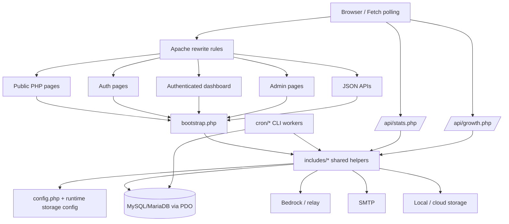
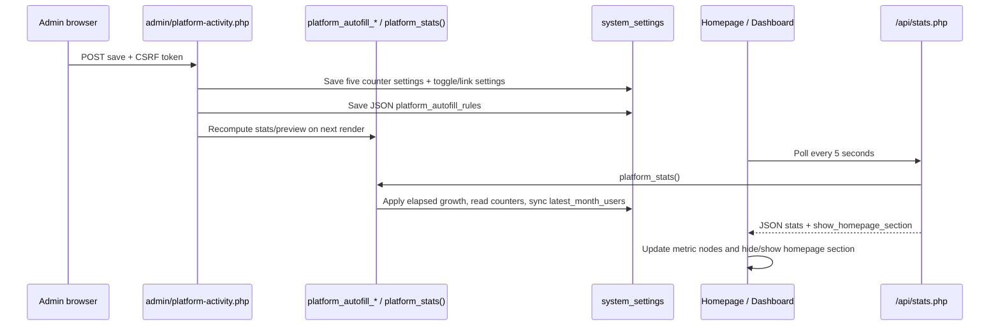
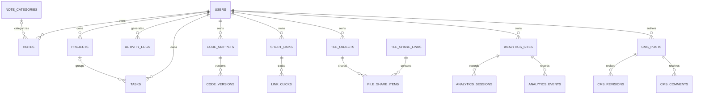

# PocketCat Workspace — Codebase Analysis (V19.72 archive)

**Analysis date:** 2026-10-21  
**Analyzed artifact:** `PocketCat-v19.72-platform-activity-autofill-live-sync.zip`, extracted to a temporary analysis copy.  
**Scope:** static source review, architecture/data-flow tracing, defensive security review, and available local PHP smoke/syntax checks. No application source files were changed during the analysis. This document is a new report; it does not replace existing project documentation.

## 1. Executive summary

PocketCat is a multi-feature PHP application built around server-rendered pages, shared procedural helper modules, MySQL/MariaDB persistence through PDO, and browser-side JavaScript for polling and interactive features. The source archive contains 438 files: 198 PHP files, 38 JavaScript files, 2 TypeScript files, 19 CSS files, 15 SQL files, and 156 Markdown documents, plus configuration and other support files. There is no Composer manifest, npm package manifest, or framework bootstrap visible in the archive. Routing is primarily Apache `mod_rewrite` to PHP scripts.

The latest platform-activity work is present in source: `/admin/platform-activity/` writes the five configurable counters and JSON Auto-Fill rules to `system_settings`; `platform_stats()` reads the configured counters, resolves the Latest Month link, and exposes the homepage visibility flag; `/api/stats.php` and `/api/growth.php` provide no-cache JSON for the public and dashboard views; `assets/js/platform-stats.js` and `assets/js/growth-chart.js` poll every five seconds; the homepage conditionally hides its LIVE WORKSPACE section; and the dashboard displays the shared counters and growth chart.

**Project health: mixed / operationally unverified.** Static PHP syntax and the existing smoke suite pass under the available CLI PHP 8.4.24 runtime. However, the suite does not cover the platform activity/Auto-Fill path, and this environment has PDO but no detected `pdo_mysql` or cURL extension, no project `storage/` runtime state, and no browser/database access. Therefore, live persistence, the cron/request-driven growth behavior, route rewriting, frontend rendering, and external integrations remain unverified.

### Highest-priority observations

1. **Medium — Auto-Fill is request-driven rather than a true background scheduler.** `platform_autofill_apply()` advances elapsed intervals only when a request reaches code that calls it. It is not a daemon or cron job. Simultaneous requests can race while reading/updating the same JSON rules and counter settings; the update is not transactionally locked. Exceptions are swallowed. See `includes/functions.php:156-186`.
2. **Medium — display counters override database-derived totals by design once a setting exists.** `platform_stats()` uses `registered_users_display`, `active_users_display`, and the three `*_counter` settings whenever non-empty, and only queries the real database counts when a setting is missing. Defaults are initialized for these keys. Thus labels such as “Registered users” can show configured/demo values rather than actual row counts. See `includes/functions.php:284-299` and the defaults around lines 277-278. This needs an explicit product decision and transparent wording.
3. **Medium — trusted-proxy assumptions are not enforced for client IPs.** `client_ip()` accepts `CF-Connecting-IP`, `X-Forwarded-For`, and `X-Real-IP` without confirming the request came through a trusted proxy. This can make IP-based logging/rate-limit identity spoofable where direct origin access is possible. See `includes/functions.php:55-63`.
4. **Medium — schema changes are coupled to web requests.** `bootstrap.php` performs schema compatibility/migration work on a first request when the schema marker is missing, and broad exceptions are logged rather than surfaced. This is convenient for shared hosting but can create concurrent deployment/migration ambiguity. See `bootstrap.php:12-26` and `ensure_platform_schema()`.
5. **Low — release metadata is inconsistent.** The archive and relevant JavaScript asset query strings/changelogs identify V19.72, but the `VERSION` file says `19.70`; bootstrap’s schema marker still says `19.68-schema-1`; the root README still opens with historical V19.2/V17.4 context. This can confuse diagnostics and deployment/cache invalidation.
6. **Coverage gap — no tests target platform counters, Auto-Fill, public section toggle, or Latest Month linking.** The current five test scripts cover policy, plan limits/catalog/UI, and webhook URL validation only.

No production database, production endpoint, external service, or paid integration was contacted. No secrets were copied into this report.

## 2. Workspace discovery and inventory

### Root and important directories

- `index.php`: public landing page and the LIVE WORKSPACE + public growth-chart markup.
- `bootstrap.php`: shared request bootstrap; loads helpers, starts session, redirects uninstalled deployments, runs schema compatibility checks and scheduled CMS publishing.
- `config.php`, `.env.example`: runtime configuration contract. `config.php` reads process environment variables; it does not itself parse `.env` files.
- `.htaccess`: Apache rewrite rules, direct-access restrictions, and baseline response headers.
- `includes/`: shared business logic, DB access, authentication, CSRF, policy/plan catalogue, AI, files/uploads/storage, links, analytics, CMS, editor, menus, QR, docs, GeoIP and UI layout helpers.
- `admin/`: server-rendered admin pages. `admin/platform-activity.php` is the relevant counter/Auto-Fill editor; `admin/site-editor.php` manages branding and growth-chart settings.
- `api/`: JSON/action endpoints; public stats/growth APIs and admin APIs are separate files.
- `dashboard/`: authenticated user dashboard, personal task metrics, shared platform stats, and growth chart.
- `auth/`: sign-in, sign-up, password reset/forgot-password/logout flows.
- `database/`: base schema plus 14 additional migration SQL files (15 SQL files total in the directory).
- `tests/`: five PHP smoke/regression scripts; no browser/E2E suite was found.
- `assets/css/`, `assets/js/`: stylesheets and browser behavior, including five-second polling for platform stats and growth chart.
- `cron/`: CLI-oriented workers for file scanning/cleanup, upload cleanup, CMS schedule publishing, visual publishing and queued link-click processing.
- `uploads/`: file/media storage roots and `.htaccess` restrictions; runtime files are not included in this archive.
- `install/`: install wizard and database/admin/service/bootstrap steps.
- `relay/`: relay implementation/configuration surface; `integrations/`: integration-specific assets/configurations.
- Public content modules include `about/`, `acceptable-use/`, `category/`, `contact/`, `cookie-policy/`, `faq/`, `features/`, `how-it-works/`, `pages/`, `posts/`, `pricing/`, `privacy/`, `product/`, `security/`, `terms/`.
- Product modules include `tasks/`, `notes/`, `projects/`, `files/`, `media/`, `file/`, `share/`, `share-management/`, `links/`, `qr/`, `code/`, `ai/`, `analytics/`, `search/`, `settings/`, `support/`, `docs/`.

### File type classification

- **Application source:** 198 PHP files, including routes, pages, helpers, endpoints, CLI workers, and installer scripts.
- **Browser source/assets:** 38 `.js` files and 2 TypeScript files, plus 19 CSS files under `assets/`.
- **Database:** 15 `.sql` files, including `database/schema.sql` and incremental migrations.
- **Documentation:** 156 Markdown files, mostly architecture notes, deployment guides, QA reports, and historical changelogs.
- **Configuration:** `.htaccess`, `.env.example`, `config.php`, `VERSION`, `Makefile`, plus PHP files under `config/` and `install/`.
- **Tests:** five PHP scripts under `tests/`.
- **Generated/runtime data:** no `storage/` directory or populated runtime state was present in the archive. `uploads/` contains only directory-level `.htaccess` files in this artifact.
- **Third-party dependency manifests:** no `composer.json`, `composer.lock`, `package.json`, npm/yarn/pnpm lockfile, Dockerfile, or Compose file was found. The project appears to rely on PHP extensions and browser-native APIs rather than a vendored framework.

### Full file inventory

The complete relative-path inventory of the analyzed archive is included in [Appendix A](#appendix-a-complete-relative-path-inventory). The list intentionally excludes no project files from the inventory; bulky runtime/vendor/build trees were not present in the extracted archive.

## 3. Technology and dependency matrix

| Component | Detected technology | Evidence | Operational implications |
|---|---|---|---|
| Server language | PHP, syntax compatible with PHP 8.x; tested on PHP 8.4.24 CLI | `declare(strict_types=1)` in selected files, typed functions, `str_starts_with`, `never` return types; local `php -v` | Deploy on a PHP 8+ runtime; confirm hosting version and extension availability. |
| Web architecture | Procedural/server-rendered PHP | `index.php`, `dashboard/index.php`, `admin/*.php`, `includes/*.php` | HTML is rendered on the server; common behavior is coupled through includes/global functions. |
| Routing | Apache `mod_rewrite` rules | `.htaccess` | Apache-compatible rewrite support is expected; other web servers need equivalent routing/security configuration. |
| Database | MySQL/MariaDB over PDO `mysql:` DSN | `includes/database.php`, `database/schema.sql` | Requires PDO MySQL driver, credentials, utf8mb4, InnoDB and compatible MySQL/MariaDB features. No live DB verification was possible. |
| Browser behavior | Vanilla JavaScript, Fetch API, DOM APIs | `assets/js/platform-stats.js`, `growth-chart.js`, numerous feature scripts | No front-end build step was identified; browser support for Fetch and modern DOM methods is assumed. |
| Styling | CSS with shared theme variables and responsive styles | `assets/css/*`, `site_theme_vars()` in `includes/functions.php` | Asset cache-busting uses query strings; no CSS compiler was identified. |
| Sessions/security | PHP sessions, cookie flags, CSRF token helpers, password hashing | `bootstrap.php`, `includes/csrf.php`, `includes/auth.php`, `auth/*` | Session storage and HTTPS detection depend on hosting/proxy configuration. |
| AI integration | Amazon Bedrock and OpenAI-compatible endpoint/relay paths using cURL | `includes/ai.php`, `api/ai-chat.php`, `.env.example` variable names | Requires cURL/OpenSSL and configured credentials/region/model; not tested against AWS. |
| Email | SMTP configuration and mail helper | `includes/mail.php`, `admin/email.php`, `.env.example` | Requires valid SMTP settings and outbound network permission. |
| File storage | Local storage plus cloud/storage abstraction, resumable upload and scanning workers | `includes/files.php`, `includes/upload-engine.php`, `includes/cloud-storage.php`, `api/files.php`, `cron/*` | Requires writable directories and optional cloud credentials/scanner endpoint. |
| Analytics/GeoIP | Internal analytics tables, local GeoIP reader/updater | `includes/analytics.php`, `includes/geo.php`, `includes/maxmind-reader.php`, `geoip/*` | Requires data files/update configuration for richer geo results. |
| Tests/build | Makefile invokes PHP test scripts and recursive `php -l` | `Makefile`, `tests/*` | `make check` is the main available local gate; it does not provide browser/database integration coverage. |
| Package management | No Composer/npm manifest detected | root inventory | Dependency provenance and automated vulnerability scanning are not defined by a package lockfile. |

**Configuration caution:** `.env.example` documents environment-variable names, but `config.php` only reads values from the process environment. Do not assume that creating a `.env` file alone configures the application unless the hosting environment separately loads it. Relevant variable names include `DB_HOST`, `DB_PORT`, `DB_NAME`, `DB_USER`, `DB_PASSWORD`, AWS/Bedrock variables, SMTP variables and `SESSION_SECURE`; secret values are deliberately not reproduced here.

## 4. Architecture and module relationships



### Request lifecycle

1. Apache routes the request through `.htaccess` to a PHP file.
2. Most application routes require `bootstrap.php`; bootstrap loads `includes/functions.php` and the rest of the shared modules, sends no-cache headers, starts a PHP session, redirects to `/install/` if no `storage/installed.lock` exists, and conditionally performs schema compatibility setup.
3. Shared helpers call `db()` for a singleton PDO connection, `setting()`/`set_setting()` for key-value settings, and `current_user()` for session-backed identity.
4. The page/endpoint enforces its local login/admin/CSRF checks and performs feature-specific work.
5. Server-rendered HTML may be refreshed by vanilla JS polling public JSON endpoints.

### Core module responsibilities

| Module | Responsibility and side effects |
|---|---|
| `bootstrap.php` | Loads all shared modules; starts session; install redirect; first-request schema checks; scheduled CMS publishing; maintenance mode handling. It may write schema/data on web requests. |
| `includes/functions.php` | Configuration, escaping, redirects, IP extraction, settings CRUD, secret encryption, plan limits, Auto-Fill and platform stats, theme helpers, runtime config. Large and cross-cutting; this is the main coupling point. |
| `includes/database.php` | PDO singleton and safe database connection test. Uses native prepares and exception mode. |
| `includes/auth.php`, `includes/admin-auth.php`, `includes/csrf.php` | Session user resolution, login/logout, role/admin-view gating, CSRF verification, JSON response helper. |
| `includes/policy.php`, `includes/plan-catalog.php` | Central policy defaults, feature/limit resolution, plan catalog and validation. Covered by current tests. |
| `includes/files.php`, `includes/upload-engine.php`, `includes/cloud-storage.php` | File records, local/cloud asset paths, upload lifecycle and storage integration. |
| `includes/links.php` | Short-link creation/redirect, webhook validation/delivery and rate-limit related behavior. |
| `includes/ai.php` | AI credential selection, request transport, Bedrock/OpenAI-compatible parsing and streamed responses. |
| `includes/analytics.php`, `includes/geo.php`, `includes/maxmind-reader.php` | Analytics schema and events, GeoIP enrichment and lookup. |
| `includes/cms.php`, `includes/editor-suite.php`, `includes/visual-engine.php` | CMS content/revisions/scheduling, live editor APIs and visual config/version workflows. |
| `includes/menu-manager.php`, `includes/qr.php`, `includes/docs.php` | Navigation, QR code configuration, documentation schema/content. |
| `admin/*` | Admin UI and form handlers. Access is mostly enforced per page via `require_admin()` or stricter helpers. |
| `api/*` | JSON/action APIs, with per-endpoint auth and CSRF patterns. These patterns are not fully uniform. |
| `cron/*` | CLI/request workers for maintenance, scanning, cleanup, publishing and queued analytics/link work. Scheduler installation is hosting-specific and not documented as a single deployment manifest. |

### Architecture concerns

- `includes/functions.php` is an oversized central module; unrelated domains share it and it is included by most requests.
- `bootstrap.php` eagerly loads many feature modules even for public pages, increasing coupling and startup work.
- Schema creation/migrations are split between `database/*.sql`, helper-specific schema functions and bootstrap-triggered compatibility changes.
- Error handling is inconsistent: some endpoints return sanitized JSON errors, while many helpers suppress exceptions to preserve availability. Suppression makes operational failures difficult to diagnose.
- Several business flows use `system_settings` as a generic key-value store, which is convenient but weakly typed and has no domain-level schema constraints.

## 5. Major business workflows and data flow

### Platform activity / Auto-Fill



Evidence: `admin/platform-activity.php:6-17`, `includes/functions.php:144-187,284-299`, `api/stats.php`, `assets/js/platform-stats.js:1-24`, `index.php:35-38`, `dashboard/index.php`.

Observed behavior and edge cases:
- Five display values are stored as settings; when set, they supersede SQL `COUNT(*)` values. The current defaults ensure that they normally exist.
- The `Show Live Workspace Section on Homepage` setting is returned as `show_homepage_section`; the JS hides/shows only the homepage section. The dashboard section is separate and does not use this visibility flag.
- Latest Month is derived from the registered-user display counter when `latest_month_linked=1`; `platform_stats()` also repairs the persisted `latest_month_users` value when it differs.
- Auto-Fill is lazy/request-driven. It catches up elapsed intervals (up to 1,000 steps per request) using `last_run`, applies the max cap, and stores updated values/rules. No platform-activity-specific cron worker was found.
- Multiple independent `set_setting()` calls are not grouped in a transaction. If a later write fails, a partially saved configuration can remain.
- The whole Auto-Fill body catches `Throwable` without logging it. A database failure can silently make counters appear frozen.
- The page’s reset action restores counter values and linked/visible flags as well as disabled rules; the action label emphasizes Auto-Fill, so the wider reset scope should remain documented.

### Growth chart settings

`demo_growth_config()` reads `growth_base`, `growth_rates`, `growth_chart_title`, `growth_chart_description`, and `growth_demo_badge`. It normalizes rates into five values, calculates a six-month series, and substitutes the Latest Month figure when linking is enabled. The public homepage and dashboard server-render this chart, and `assets/js/growth-chart.js` refreshes it from `/api/growth.php` every five seconds. The API returns the title, description, badge state and series with no-cache headers. No browser/network test was available to confirm live update timing.

### Authentication and account creation

- Login looks up an active user by email or username, verifies `password_hash`, regenerates the session ID in `login_user()`, and sends admins to `/admin/` or users to `/dashboard/`.
- Sign-up uses CSRF, validates email and minimum password length, inserts a user with `password_hash()`, and logs the user in.
- `current_user()` loads the session user from the database, rejects non-active users, and updates `last_seen_at` at most once per minute per session.
- `require_admin()` requires login, role `admin`, and `admin_view` mode. `require_admin_permission()` adds policy permission checks; individual admin pages should be audited for whether the narrower permission helper is appropriate.
- Password reset uses hashed reset tokens and expiration timestamps. Dynamic behavior and mail delivery were not runtime-tested.

### Tasks, notes and projects

The main pages are `tasks/`, `notes/`, and `projects/`, with create/edit/delete scripts and API scripts for tasks/notes/projects. Base tables include `user_id` ownership columns and foreign keys to `users`; task projects and note categories have relationships. Plan limits are computed from the policy plan catalogue and checked by helper logic. This was statically inspected; no live DB integration tests were run.

### File upload, sharing and scanning

Uploads flow through `api/upload-chunk.php`, `api/files.php`, `includes/upload-engine.php`, `includes/files.php` and storage adapters. Metadata lives in `file_objects` and related tables; share links/items and file versions are relational. `cron/file_scan.php` handles pending scans, `cron/file_cleanup.php` and `cron/upload_cleanup.php` remove stale items, and `.htaccess` in uploads disables indexes/CGI and blocks script extensions. Scanner, cloud provider, and actual filesystem permissions were not exercised.

### AI and external integrations

`includes/ai.php` chooses credentials/settings, sends requests through cURL to Bedrock-compatible endpoints or a configured relay, parses responses and supports streaming. SMTP is handled through `includes/mail.php`. GeoIP, analytics, storage providers and webhooks are implemented through dedicated helpers. No external API was called during analysis; credentials and network permissions remain deployment-specific.

## 6. Database and data model

### Database implementation

- Driver: PDO with a MySQL DSN and `charset=utf8mb4` (`includes/database.php`).
- PDO uses exception mode, associative fetches and `ATTR_EMULATE_PREPARES=false`.
- `database/schema.sql` defines 76 `CREATE TABLE` statements. `database/` contains 15 SQL files total, including the base schema and incremental migrations.
- Many modules also provide idempotent `CREATE TABLE`/`ALTER TABLE` helpers. `bootstrap.php` uses a marker file to avoid running the compatibility setup on every request.
- No live database connection was attempted. Runtime table existence, migration order, constraints against an existing installation, backups, and rollback behavior are unverified.

### Core ER diagram (simplified)



`system_settings` is a key-value table rather than a relational entity; its key is the primary key and the application stores serialized JSON values for policy, Auto-Fill and other settings.

### Main tables and relationships

- **Identity/workspace:** `users`, `tasks`, `projects`, `notes`, `note_categories`, `milestones`, `conversations`, `conversation_messages`, `activity_logs`.
- **Configuration/policy:** `system_settings`, `schema_version`, `policy_user_overrides`, `policy_audit_logs`, `admin_roles`, `user_admin_roles`, `admin_impersonation_logs`, `global_block_rules`.
- **AI/support/contact:** `ai_settings`, `user_ai_settings`, `ai_usage_daily`, `email_settings`, `contact_messages`, `support_threads`, `support_messages`, `chat_attachments`, `password_resets`.
- **Links/QR/webhooks:** `short_links`, `qr_designs`, `link_clicks`, `link_api_tokens`, `link_webhooks`, `link_webhook_deliveries`, `link_rate_limits`, `link_click_queue`, `webhook_delivery_log`.
- **Files/sharing:** `file_objects`, `upload_sessions`, `file_uploads`, `file_events`, `file_webhooks`, `file_webhook_deliveries`, `file_api_tokens`, `file_abuse_blocks`, `file_abuse_history`, `file_versions`, `file_share_links`, `file_share_items`, `file_share_events`, `storage_connections`, `storage_audit_events`.
- **Code/docs:** `code_snippets`, `code_versions`, `code_categories`, `code_access_events`, `documentation_entries`.
- **Analytics/GeoIP:** `analytics_sites`, `analytics_sessions`, `analytics_events`, `analytics_goals`.
- **CMS:** `cms_categories`, `cms_posts`, `cms_tags`, `cms_post_tags`, `cms_post_categories`, `cms_revisions`, `cms_comments`, `cms_post_meta`, `cms_user_preferences`.
- **Media:** `media_assets`, `media_audit_events`, `media_collections`, `media_collection_items`.

### Data-model concerns

- Generic text settings are weakly typed; application-level validation is required for numeric, enum and JSON values.
- Multiple schema sources (base SQL, migrations, helper migrations) make it harder to prove that a fresh install and long-lived install converge on the same schema.
- Several migration helpers catch all exceptions, which can conceal “already exists” (expected) and genuine migration failures (unexpected) in the same way.
- Indexes exist on common ownership/time columns in many tables, but no query-plan or production cardinality analysis was performed. Do not make index changes without EXPLAIN and data-volume measurements.
- Backups, recovery drills and migration rollback procedures were not present as an executable deployment workflow in the inspected archive.

## 7. API and integration inventory

The API surface is PHP-file routed, with rewrites in `.htaccess` for many paths. The list below is based on actual endpoint files, not a claim that every action/parameter has been exhaustively documented.

| Endpoint file | Purpose | Access/control observations |
|---|---|---|
| `api/stats.php` | Public platform counter JSON | No login check; no-cache response. Expected for public live metrics, but exposes configured values to anonymous visitors. |
| `api/growth.php` | Public growth chart JSON | No login check; no-cache response; returns chart config and series. Expected for public chart. |
| `api/plans.php`, `api/admin/plans.php` | Public plan catalogue / admin plan changes | Public read catalogue; admin writes check role/admin-view/super-admin permission and CSRF. |
| `api/admin-links.php`, `api/links.php`, `api/create-link.php`, `api/link-events.php` | Link CRUD, events and webhooks | Auth/CSRF/rate limiting varies by action; `api/admin-links.php` checks login, CSRF header and PATCH. |
| `api/files.php`, `api/upload-chunk.php`, `api/media.php`, `api/media-share.php`, `api/share-management.php` | File APIs, upload/download/preview/sharing | File-level ownership/token checks exist in handlers; each action should be regression-tested for ownership and token expiry. |
| `api/ai-chat.php`, `api/ai-action.php`, `api/chat-upload.php`, `api/chat-attachment.php` | AI requests and attachments | Uses configured credentials and upload/file policies; outbound Bedrock/relay calls not tested. |
| `api/analytics/collect.php`, `site.php`, `report.php` | Analytics collection/site/reporting | Site ownership, consent and payload validation should be tested against live schema; not runtime-tested. |
| `api/admin/editor-suite/index.php` | Editor draft/publish/revisions/media upload | Requires admin and CSRF; actions write content/revisions or uploads. Method checks are not uniformly explicit for every action. |
| `api/admin/visual-engine/index.php` | Visual config read/validate/publish/rollback | Uses `require_super_admin()`, CSRF on POST, base-version conflict check and transaction for publish. |
| `api/menu/index.php`, `api/menu/save/index.php` | Navigation menu reads/saves | Inspect the individual role/CSRF controls before modifying. |
| `api/code.php`, `api/qr-design.php`, `api/secret.php`, `api/support.php`, `api/support-chat.php`, `api/growth.php` | Code, QR, secret, support and growth features | Endpoint-specific auth/validation; see files before extending. |

**Integration inventory:** Amazon Bedrock and optional relay (`includes/ai.php`); SMTP (`includes/mail.php`); local/cloud file storage (`includes/cloud-storage.php` and storage helpers); optional malware scanner via configured URL (`cron/file_scan.php`); webhook destinations and delivery (`includes/links.php`); GeoIP/MaxMind data; analytics collection. These were inspected statically only. No production requests were sent.

### Complete API handler file list

- `api/admin-links.php` — admin link operations.
- `api/admin/editor-suite/index.php` — editor save/revisions/restore/media upload.
- `api/admin/plans.php` — administrator plan catalogue mutation.
- `api/admin/visual-engine/index.php` — visual configuration/version actions.
- `api/ai-action.php`, `api/ai-chat.php` — AI actions and chat.
- `api/analytics/collect.php`, `api/analytics/report.php`, `api/analytics/site.php` — analytics event collection, reporting and site management.
- `api/chat-attachment.php`, `api/chat-upload.php` — chat attachment upload/access.
- `api/code.php` — code-snippet API.
- `api/create-link.php`, `api/links.php`, `api/link-events.php` — short-link creation/management/events.
- `api/files.php`, `api/upload-chunk.php`, `api/media.php`, `api/media-share.php`, `api/share-management.php` — file/media/upload/share workflows.
- `api/growth.php`, `api/stats.php` — public growth chart and platform counters.
- `api/menu/index.php`, `api/menu/save/index.php` — menu retrieval and saving.
- `api/plans.php` — public plan catalogue.
- `api/qr-design.php` — QR design settings.
- `api/secret.php` — secret-setting retrieval/update bridge; sensitive access requires careful review.
- `api/support.php`, `api/support-chat.php` — support operations.
- `api/links` is also routed to `api/links.php` by `.htaccess`; several friendly routes are rewrite aliases rather than separate handlers.

## 8. Authentication and authorization

- Session cookie parameters in `bootstrap.php` include `httponly`, `samesite=Lax`, root path, and `secure` when `$_SERVER['HTTPS']` is non-empty and not `off`.
- `login_user()` regenerates the session ID and stores the user ID. Passwords use `password_hash()` and `password_verify()`.
- Forms generally use `csrf_field()` and POST handlers call `verify_csrf()`. JSON endpoints often compare a CSRF header/body token.
- Admin access requires an active session user with `role='admin'` and `admin_view` mode. `require_super_admin()` additionally checks the wildcard permission.
- Ownership is commonly modeled by `user_id` columns and foreign keys, but IDOR prevention must be verified per handler; the number of APIs makes this a high-value regression suite.
- Login code inspected does not show an obvious per-account login throttle in `auth/login.php`; policy rate limiting exists for certain APIs/links but should not be assumed to cover sign-in. Confirm hosting/WAF protections before production hardening.
- Cookie `secure` depends on the web server’s HTTPS variable. If TLS terminates at a proxy and the origin sees plain HTTP without trusted HTTPS forwarding, cookies could be issued without `Secure`; verify the actual host/proxy setup.

## 9. Defensive security review

Findings are static observations and are not proof of exploitability unless explicitly stated.

| ID | Severity / confidence | Location | Evidence and impact | Recommended remediation / regression test |
|---|---|---|---|---|
| SEC-01 | Medium / High | `includes/functions.php:55-63` (`client_ip`) | Client-controlled forwarding headers are accepted without a trusted-proxy allowlist. An attacker with direct origin access can spoof IP identity used by logs and some IP-based controls. | Trust proxy headers only when `REMOTE_ADDR` is an approved proxy; parse one canonical address; test spoofed XFF/CF headers from untrusted source and trusted proxy paths. |
| SEC-02 | Medium / Medium | `bootstrap.php:17-26`; `ensure_platform_schema()` | Schema setup is executed from web requests and failures are caught/logged; simultaneous first requests or a partial migration can leave deployment state unclear. | Prefer a controlled deployment/CLI migration step; use explicit schema versions/locks; log migration failures distinctly; test fresh and upgrade installs on disposable DB snapshots. |
| SEC-03 | Low–Medium / Medium | `api/admin/editor-suite/index.php:8` | Upload code checks detected MIME category but keeps an extension derived from the original filename (sanitized only to alphanumeric characters). Upload-directory `.htaccess` blocks common script extensions, reducing risk on Apache, but other hosting configs or less common executable extensions need validation. | Use a strict MIME-to-extension allowlist, generate extension from detected MIME, verify content signatures, and test dangerous extensions under the actual hosting server. |
| SEC-04 | Medium / Medium | `includes/functions.php:156-186` | Auto-Fill state and counters are updated with multiple independent writes, without transaction/row lock; exceptions are swallowed. Concurrent requests can race or hide failed updates. | Move advancement into a transactional service with atomic compare-and-set/locking; log errors; test concurrent API requests, cap handling and partial DB failure. |
| SEC-05 | Low / High | `VERSION`, `bootstrap.php:14`, changelog/asset versions | Release metadata is inconsistent (archive/changelog assets indicate V19.72, `VERSION` reports 19.70, schema marker says 19.68). | Update version/schema marker in a release process and test asset invalidation/migration idempotency. |
| SEC-06 | Informational / High | `api/stats.php`, `api/growth.php` | Public endpoints expose public-facing counters and chart configuration without auth. This appears intentional, but it should be treated as public data. | Document public data contract; do not add private user-level data to these payloads; add schema tests that assert only intended fields are emitted. |
| SEC-07 | Medium / Medium | `auth/login.php` and authentication flow | No obvious account/IP throttling is visible in the login handler itself; password reset and login endpoints are sensitive brute-force targets. | Add or verify edge/WAF rate limits, progressive delays/lockout policy and audit logs; test repeated failures without enabling account-enumeration responses. |
| SEC-08 | Low / High | `.htaccess:151-158` | Baseline headers include `nosniff`, `SAMEORIGIN`, and `Referrer-Policy`, but no Content-Security-Policy or Permissions-Policy is visible in this block. | Evaluate CSP in report-only mode first, accounting for inline scripts and integrations; add Permissions-Policy after compatibility review. |

Positive controls observed: PDO native prepares; HTML escaping helper `e()`; CSRF helpers; password hashing; session ID regeneration; HTTPS-only/public-DNS checks for webhook targets; `.htaccess` restrictions under upload directories; visual engine version conflict checks and transaction around publish.

- **SEC-09 — Low / High confidence, documentation hygiene:** selected deployment/architecture Markdown files contain environment-specific hosting identifiers and an integration endpoint. These are not database passwords or API tokens in the inspected text, but they can reveal deployment topology if the archive is distributed publicly. Review and generalize deployment identifiers before publishing the repository; add a documentation secret/metadata scan to release checks.

No dependency vulnerability scan could be run because package manifests/lockfiles were not found and no network-based scanner was used. No secrets were printed or tested.

## 10. Bugs, edge cases and reliability

### Confirmed from static code

- **BEH-01 — release version mismatch:** `VERSION` contains `19.70` while archive/changelog/browser asset query strings use `19.72`.
- **BEH-02 — request-driven Auto-Fill:** elapsed increments are only applied during requests that invoke `platform_autofill_apply()`; there is no independent scheduler for these five counters. If traffic stops, counters do not advance until a later request.
- **BEH-03 — race/partial-update possibility:** Auto-Fill reads JSON rules and setting values, calculates updates in PHP, then writes them separately. Concurrent requests can read the same old `last_run` and apply duplicate increments; partial writes are possible.
- **BEH-04 — silent Auto-Fill failure:** exceptions in `platform_autofill_apply()` are swallowed; operators have no log signal when growth fails.
- **BEH-05 — configured counters take precedence over actual counts:** default settings mean the public metrics generally represent editable display counters, not SQL-derived totals. This may be intended as a demo/marketing feature but conflicts with literal “real counts” expectations.

### Potential defects requiring runtime verification

- **BEH-06 — forwarded client IP trust:** impact depends on reverse-proxy/origin topology.
- **BEH-07 — schema marker drift:** `bootstrap.php` marker is not aligned with archive release metadata. Whether a new migration is missed depends on which schema changes the release actually requires.
- **BEH-08 — browser polling and error behavior:** polling suppresses fetch errors and leaves server-rendered state in place. This is graceful, but the user receives no visible stale-data indicator; browser network/console checks were unavailable.
- **BEH-09 — public metrics consistency under load:** public API requests can mutate settings by applying Auto-Fill and synchronizing Latest Month. A read endpoint is therefore not read-only. Concurrent traffic and DB latency should be tested.

No syntax errors were observed in the PHP files. No live HTTP status codes, redirects, browser layout, DB queries or scheduled-job behavior were verified.

## 11. Frontend and user experience

- Public pages use server-rendered HTML and shared `public_header()` / `public_footer()` helpers.
- Authenticated pages use `includes/header.php`, `includes/navbar.php` and `includes/sidebar.php`; responsive styling lives under `assets/css/`.
- Homepage public counters are tagged with `data-platform-stat`; the client script fetches `/api/stats.php` immediately and then every five seconds, pausing while the document is hidden. It toggles only `[data-live-workspace-section="homepage"]`.
- Dashboard has a separate shared activity strip and growth chart, with `platform-stats.js` and `growth-chart.js` included.
- Growth chart DOM is replaced from validated JSON via `createElement`/`textContent`, which avoids injecting returned labels/descriptions as HTML.
- Static review only: no real mobile/desktop browser, screen reader, keyboard-navigation, layout-overflow, or JavaScript console tests were possible.

### User journeys and change impact

| User journey | Main files | Regression surface |
|---|---|---|
| Admin changes activity counters | `admin/platform-activity.php`, `includes/functions.php`, `system_settings` | CSRF, role gate, persistence, preview values, caps, reset scope |
| Public visitor sees live counters | `index.php`, `api/stats.php`, `assets/js/platform-stats.js` | section visibility, exact five metrics, polling and no-cache behavior |
| Signed-in user sees counters/chart | `dashboard/index.php`, `api/stats.php`, `api/growth.php`, `assets/js/*` | login, stats, chart title/series, Latest Month link |
| Admin changes growth chart settings | `admin/site-editor.php`, `includes/functions.php`, `api/growth.php`, `assets/js/growth-chart.js` | form validation, saved settings, cache invalidation/polling, escaping |
| User uploads/shares a file | `api/files.php`, `api/upload-chunk.php`, `includes/files.php`, `includes/upload-engine.php`, `uploads/.htaccess` | ownership, size/MIME validation, partial uploads, cleanup, share tokens |
| Admin publishes content | `admin/*`, `api/admin/editor-suite/index.php`, `includes/cms.php` | CSRF, sanitizer, revisions, upload types, rollback and scheduling |

## 12. Performance and scalability

- **Request bootstrap cost:** `bootstrap.php` eagerly requires many modules; measure PHP request startup before splitting into lazy feature loading.
- **Repeated settings queries:** `setting()` performs a query per key and does not cache settings within a request. `platform_stats()` reads several keys and may write synchronization values; site editor and other admin pages can cause many small queries. A request-local settings cache with explicit invalidation could reduce overhead.
- **Public polling:** each open homepage/dashboard polls stats and growth every five seconds. Each endpoint opens/uses DB and the stats path can write settings. Consider a bounded cache or a combined endpoint after preserving immediate invalidation and no stale cross-user state.
- **Auto-Fill catch-up:** up to 1,000 increments per metric per request; with five metrics and long outages, this can add latency. Percentage mode rounds each step and loops per interval; define whether catch-up should simulate every step or calculate bounded aggregates.
- **Analytics/event data:** several tables can grow continuously. Retention settings/workers exist in parts of the application; verify that all high-volume tables have a documented retention job and indexes using EXPLAIN and realistic data.
- **File/AI calls:** cURL timeouts vary by integration; large downloads may have no total timeout. Validate hosting resource limits and streaming behavior before scaling.

No performance measurements or database query plans were obtained. Recommendations are hypotheses to benchmark, not measured improvements.

## 13. Code quality and maintainability

- Procedural PHP is consistent with the current architecture but lacks strict separation between HTTP controllers, domain services and persistence.
- `includes/functions.php` is particularly broad; Auto-Fill, settings, plan limits, crypto, client IP and themes share one module.
- Several files are compressed into very long lines, making reviews, line-level diffs and static diagnostics harder.
- Tests are simple executable smoke checks; no PHPUnit/Pest or browser testing configuration was found.
- `Makefile` provides a repeatable `test`, `lint`, and `check` workflow.
- Historical changelog/architecture documents are numerous and useful, but release metadata should be reconciled to avoid conflicting source-of-truth signals.
- Configuration and domain settings are stored as untyped key/value strings; schema and normalization tests should cover them.

## 14. Testing strategy and actual results

### Existing tests

| Command/test | Actual result |
|---|---|
| `php tests/check-policy.php` | Passed: testing-mode defaults/flags, quotas and testing overrides. |
| `php tests/check-plan-limits.php` | Passed: Free/Basic/Premium quota mapping. |
| `php tests/check-plan-catalog.php` | Passed: plan validation and byte-allocation boundaries. |
| `php tests/check-plan-catalog-ui.php` | Passed: shared catalogue/UI/API contracts and cache refresh checks. |
| `php tests/check-webhook-target.php` | Passed: rejects HTTP, localhost, loopback/private IPs and credential-bearing URLs. |
| `make check` | Passed all above tests and recursively ran `php -l` on every PHP file; no syntax errors observed. |

Environment: PHP CLI 8.4.24. `php -m` showed PDO, OpenSSL and fileinfo, but no `pdo_mysql` or cURL in this runtime. Therefore these results prove PHP parsing and the test scripts’ logic only; they do not prove database, browser, mail, AI, cloud storage or production behavior.

### Recommended test matrix (highest risk first)

| Area | Essential cases |
|---|---|
| Auto-Fill unit | Manual numeric exact increments; random bounds; percentage rounding; zero amount; zero/unlimited max; max cap; disabled metric; each supported interval; elapsed 0/1/many intervals; 1,000-step catch-up boundary. |
| Auto-Fill integration | Save then reload settings; partial DB failure; concurrent requests; simultaneous API polling; last_run persistence; reset semantics; DB transaction rollback. |
| Live Workspace toggle | Save ON/OFF; homepage initial HTML state; API state; polling updates without hard refresh; ensure dashboard visibility policy is explicitly defined. |
| Latest Month | Linked value equals configured registered users in admin preview, growth chart and API; unlinked value remains independent; value changes immediately on save. |
| Auth/CSRF | Anonymous admin access, non-admin access, admin-view state, invalid/missing CSRF, session fixation, expired password reset, repeated login failures. |
| Authorization/IDOR | Cross-user task/note/project/file/link access, share-token expiration/revocation, file download and preview ownership. |
| File upload | Size/MIME/signature mismatch, executable extensions, polyglot files, path traversal, chunk reorder/replay, cleanup after interrupted upload. |
| API contract | HTTP methods, JSON schema, status codes, no-cache headers, malformed JSON, missing/extra fields, rate limiting and error leakage. |
| DB/migrations | Fresh install, upgrade from each supported schema version, repeated migration, concurrent first request, backup/restore, failed migration recovery. |
| Browser/E2E | Mobile/desktop viewport, five-second refresh, hidden tab/resume, network failure, accessibility/keyboard, chart overflow and empty values. |
| Integrations | Bedrock timeout/429/5xx/invalid JSON; SMTP failures; webhook retries/idempotency/redirects; scanner timeout; cloud storage credentials and partial failures. |

## 15. Local development and deployment requirements

### Detected requirements

- PHP 8.x; the inspected CLI was PHP 8.4.24.
- PHP extensions: PDO plus **PDO MySQL** for DB use; OpenSSL and fileinfo are used; cURL is used by AI/webhook/file scanning/storage flows. Other modules may be required by specific features (for example, image/PDF processing should be checked against the implementation before enabling those features).
- MySQL/MariaDB database initialized from `database/schema.sql` and applicable migrations/installer flow.
- Apache with `mod_rewrite` and `.htaccess` overrides, or equivalent manually configured routing/security rules.
- Writable `storage/`, `uploads/` and relevant subdirectories; `storage/installed.lock`, runtime configuration, app secret and schema marker are generated/maintained at runtime.
- Environment variables or installer-created runtime config for DB credentials; optional Bedrock/relay and SMTP variables; optional cloud storage/scanner/GeoIP configuration.
- Host-specific cron jobs for the scripts under `cron/` and GeoIP updates if enabled.

### Safe setup/verification sequence

1. Use a disposable local database and a copy of the project; do not point local checks at production.
2. Install PHP extensions and confirm `php -m` includes `pdo_mysql`, `curl`, `openssl`, and `fileinfo` as appropriate.
3. Review `install/` flow and `DEPLOYMENT-*.md` instructions; do not run destructive initialization against an existing database.
4. Configure runtime environment variables or use the documented installer path. `config.php` reads process environment; `.env.example` is a template, not proof that `.env` is loaded.
5. Apply the base schema and the correct migrations through the project’s supported install/update path; verify schema versions on a snapshot before production.
6. Ensure `storage/` is not web-accessible, `uploads/` script execution is disabled, HTTPS is correctly detected behind any proxy, and backup/restore is tested.
7. Run `make check`; then execute DB-backed integration tests, browser tests, and safe smoke tests against localhost.
8. Configure and monitor cron workers; explicitly decide whether Auto-Fill counters should use a real cron job or remain request-driven.
9. Deploy with a rollback plan and compare `VERSION`, changelog, schema marker and asset versions.

No local server was started, no database was created/modified, and no credentials were provisioned during this analysis.

## 16. Prioritized remediation roadmap

1. **P0 before calling platform activity production-safe:** add unit/integration coverage for all Auto-Fill modes, interval catch-up, max cap, Latest Month link and toggle; make the update atomic or explicitly document request-driven semantics; log exceptions.
2. **P1 data semantics:** decide whether homepage figures are actual database totals or configurable presentation/demo counters. If configurable values are intentional, label them clearly; if they are actual totals, derive from SQL and keep demo metrics separate.
3. **P1 security hardening:** trust forwarding headers only from configured proxy IPs; confirm login throttling; enforce strict media upload extension/MIME allowlists.
4. **P1 deployment reliability:** move schema mutations to a controlled migration step where feasible, make schema versioning explicit, and add fresh-install/upgrade tests.
5. **P2 release hygiene:** align `VERSION`, changelog and schema marker versioning; document the release procedure and cache invalidation.
6. **P2 performance:** profile request bootstrap, setting query volume and five-second polling; use measurements to choose request-local cache or combined endpoint.
7. **P2 quality:** introduce a test framework gradually and add browser/E2E automation for admin, dashboard and public site journeys.

## 17. Unverified areas and tooling limitations

- No browser/Playwright/Selenium session was available; UI findings are static.
- No MySQL PDO driver was detected in the analysis PHP runtime, so no database connection or migration was attempted.
- No production endpoints or external services were contacted; AWS Bedrock, SMTP, cloud storage, GeoIP downloads and webhook delivery are not runtime-verified.
- No package lockfiles/manifests were present for automated dependency audit; no third-party vulnerability scan was run.
- No production data, runtime storage, secrets, or hosting config was available in the extracted archive. `storage/` is absent, so installed-state behavior and generated app configuration cannot be verified.
- The archive name says V19.72 but the `VERSION` file says V19.70 and the root README begins with older release notes; the analysis describes the source contents actually inspected, not a claim that production is running that exact archive.
- No changes were made to application source or production configuration. Only this analysis document was added to the temporary project copy for delivery.

## 18. Future change readiness checklist

Before changing a feature:

- [ ] Confirm the exact project/archive and release metadata (`VERSION`, changelog, asset query strings).
- [ ] Trace route in `.htaccess` to page/API, then follow includes/helpers and SQL writes.
- [ ] Identify authentication, role, ownership and CSRF checks for every read/write action.
- [ ] Review schema, migrations, setting defaults and compatibility helpers; use a disposable database.
- [ ] Check whether browser polling/cache invalidation must be updated as well as server-rendered HTML.
- [ ] Add a regression test for normal, invalid, missing, unauthorized, boundary and failure cases.
- [ ] Run `make check`; then run DB/API/browser tests in an environment with required extensions.
- [ ] Verify responsive behavior and browser console/network errors.
- [ ] Review logging, rollback and partial failure behavior; do not swallow unexpected exceptions silently.
- [ ] Do not test with production credentials/data or make paid/external calls without authorization.

### Common feature change map

- **Counters/growth chart:** `admin/platform-activity.php`, `admin/site-editor.php`, `includes/functions.php`, `api/stats.php`, `api/growth.php`, `index.php`, `dashboard/index.php`, `assets/js/platform-stats.js`, `assets/js/growth-chart.js`, `system_settings`.
- **Plans/quotas/billing:** `includes/policy.php`, `includes/plan-catalog.php`, `includes/plan-card.php`, `admin/plans.php`, `api/plans.php`, `api/admin/plans.php`, `billing/index.php`, `pricing/index.php`, tests under `tests/check-plan-*`.
- **Authentication/admin:** `bootstrap.php`, `includes/auth.php`, `includes/admin-auth.php`, `includes/csrf.php`, `auth/*`, `admin/toggle.php`, each admin/API handler.
- **Files/sharing:** `includes/files.php`, `includes/upload-engine.php`, `includes/cloud-storage.php`, `api/files.php`, `api/upload-chunk.php`, `file/*`, `share-management/*`, `cron/file_*`, upload `.htaccess`, schema/migrations.
- **AI:** `includes/ai.php`, `api/ai-chat.php`, `api/ai-action.php`, `api/chat-*`, `settings/ai.php`, `admin/ai.php`, `.env.example`, user/system settings.
- **CMS/editor:** `includes/cms.php`, `includes/editor-suite.php`, `includes/visual-engine.php`, `admin/posts*`, `admin/pages*`, `api/admin/editor-suite/index.php`, `api/admin/visual-engine/index.php`, `cron/cms_schedule.php`, relevant schema tables.

## Appendix A. Complete relative-path inventory

The following list is generated from the analyzed source archive before this report was added; it includes every source-archive file (including historical docs/changelogs and configuration). Directory-only entries are described in Section 2.


```text
.env.example
.htaccess
BYOD-E2EE-ARCHITECTURE.md
CHANGELOG-CMS-OVERHAUL-PHASE1.md
CHANGELOG-CMS-OVERHAUL-PHASE2.md
CHANGELOG-CMS-OVERHAUL-PHASE3.md
CHANGELOG-CMS-OVERHAUL-PHASE4.md
CHANGELOG-CMS-OVERHAUL-PHASE5.md
CHANGELOG-CMS-OVERHAUL-PHASE6.md
CHANGELOG-PROFESSIONAL-UI.md
CHANGELOG-V10.1.md
CHANGELOG-V10.2.md
CHANGELOG-V11.0.md
CHANGELOG-V11.1.md
CHANGELOG-V11.10.md
CHANGELOG-V11.11.md
CHANGELOG-V11.12.md
CHANGELOG-V11.2.md
CHANGELOG-V11.22-RESPONSIVE-UI.md
CHANGELOG-V11.23-RESPONSIVE-SYSTEM.md
CHANGELOG-V11.24-LINK-QR-FUNCTIONAL-RESPONSIVE.md
CHANGELOG-V11.25-CODE-EDITOR-PRO.md
CHANGELOG-V11.26-SEARCH-EDITOR-FIX.md
CHANGELOG-V11.27-API-ACCESS-ANALYTICS.md
CHANGELOG-V11.28-UI-BEDROCK-BILLING-API-FIX.md
CHANGELOG-V11.29-RESPONSIVE-AI-BILLING-FIX.md
CHANGELOG-V11.30-SITE-SETTINGS-RESPONSIVE-FIX.md
CHANGELOG-V11.31-LINK-ENGINE-LIVE-ANALYTICS-GEO-FAILOVER.md
CHANGELOG-V11.32-FILE-UPLOAD-FIX.md
CHANGELOG-V11.33-FILE-UPLOAD-HOSTING-FIX.md
CHANGELOG-V11.34-MEDIA-LIBRARY-OVERHAUL.md
CHANGELOG-V11.35-LINK-CREATE-FIX.md
CHANGELOG-V11.36-USER-MEDIA-LIBRARY.md
CHANGELOG-V11.37-FILE-UPLOAD-SHARING-HARDENING.md
CHANGELOG-V11.38-UNIVERSAL-UPLOAD-HARDENING.md
CHANGELOG-V11.39-UNIVERSAL-STORAGE-MEDIA-FIX.md
CHANGELOG-V11.40-ADVANCED-ANALYTICS.md
CHANGELOG-V11.42-LOCAL-GEOIP-SSE.md
CHANGELOG-V11.43-GEOIP-UI-CLEANUP.md
CHANGELOG-V11.44-FILE-UPLOAD-UI-CLEANUP.md
CHANGELOG-V11.45-CODE-CANCEL-BUTTON-REMOVAL.md
CHANGELOG-V11.46-CODE-BUTTON-FIX.md
CHANGELOG-V11.48-GEOIP-LOOKUP-FIX.md
CHANGELOG-V11.49-FILE-UPLOAD-FIX.md
CHANGELOG-V11.5.md
CHANGELOG-V11.50-CODE-SERVER-ERROR-FIX.md
CHANGELOG-V11.52-WORKSPACE-MULTI-FILE-UPLOAD-DOWNLOAD.md
CHANGELOG-V11.55-AI-ATTACHMENTS-MULTI-UPLOAD.md
CHANGELOG-V11.56-AI-CHAT-AGENT-FIX.md
CHANGELOG-V11.57-SEARCH-RESULT-10S-HIGHLIGHT.md
CHANGELOG-V11.58-SUPPORT-CHAT-PLAN-FIX.md
CHANGELOG-V11.6.md
CHANGELOG-V11.7.md
CHANGELOG-V11.8.md
CHANGELOG-V11.9.md
CHANGELOG-V12-FILE-SHARING-INTEGRATED-LINK-ENGINE.md
CHANGELOG-V13-FILE-PROVENANCE-UPLOAD-FIX.md
CHANGELOG-V14-MEDIA-FILES-UNIFIED-SYNC.md
CHANGELOG-V15-TESTING-MODE-BILLING.md
CHANGELOG-V15.1-GEOIP-AUTO-SETUP-FIX.md
CHANGELOG-V15.2-ADMIN-USER-VIEW-MEDIA-LIBRARY.md
CHANGELOG-V15.3-FILE-STORAGE-500-FIX.md
CHANGELOG-V15.4-FILE-MEDIA-500-RESILIENCE.md
CHANGELOG-V15.5-ADMIN-MEDIA-LIBRARY-VIEW.md
CHANGELOG-V15.6-CONSOLIDATED-FIX.md
CHANGELOG-V16.1-FUNCTIONAL-FIX.md
CHANGELOG-V16.2-SEARCH-NAVIGATION.md
CHANGELOG-V16.3-LIVE-CODE-EDITOR-FUNCTIONAL-FIX.md
CHANGELOG-V16.4-CMS-EDITOR-RESPONSIVE-FUNCTIONAL-FIX.md
CHANGELOG-V16.5-AI-RESPONSIVE-FUNCTIONAL-HARDENING.md
CHANGELOG-V16.6-AI-GEOIP-HARDENING.md
CHANGELOG-V16.7-SITE-EDITOR-GEOIP-QA-FIX.md
CHANGELOG-V16.8-SITE-EDITOR-SETTINGS-QA-HARDENING.md
CHANGELOG-V16.9-ADMIN-FILE-MODERATION-MOBILE-QA.md
CHANGELOG-V17.0-UPLOAD-ADMIN-MOBILE-QA.md
CHANGELOG-V17.1-MEDIA-UPLOAD-QA.md
CHANGELOG-V17.2-VERSION-DETAILS.md
CHANGELOG-V17.3-VERSION-DETAILS.md
CHANGELOG-V17.4-ADVANCED-UPLOAD-SYSTEM.md
CHANGELOG-V17.5-ADVANCED-BULK-UPLOAD-SYSTEM.md
CHANGELOG-V17.6-ADVANCED-UPLOAD-HARDENING.md
CHANGELOG-V17.7-ADVANCED-UPLOAD-SYSTEM.md
CHANGELOG-V17.8-ADVANCED-UPLOAD-SYSTEM.md
CHANGELOG-V17.9-ADVANCED-MEDIA-WORKFLOWS.md
CHANGELOG-V18.0-UNIVERSAL-MEDIA-VIEWER.md
CHANGELOG-V18.1-BULK-SELECTION-ARCHIVES.md
CHANGELOG-V18.2-MEDIA-LIBRARY-PREFERENCES.md
CHANGELOG-V18.3-RESILIENT-MEDIA-UPLOADER.md
CHANGELOG-V18.4-PRODUCTION-MEDIA-EXPANSION.md
CHANGELOG-V18.5-SECURE-OTA-UPDATER.md
CHANGELOG-V18.6-FILE-STORAGE-SHARING.md
CHANGELOG-V18.7-UNIVERSAL-MEDIA-VIEWER.md
CHANGELOG-V18.8-BULK-SELECTION-DOWNLOAD-DELETE.md
CHANGELOG-V18.9-FILE-STORAGE-PREFERENCES.md
CHANGELOG-V19.0-ENTERPRISE-BULK-UPLOADER.md
CHANGELOG-V19.1-PRODUCTION-EXPANSION.md
CHANGELOG-V19.2-UNIVERSAL-PATH-RESILIENCE-OTA.md
CHANGELOG-V19.3-FILE-STORAGE-QA-RESPONSIVE-DOWNLOAD-FIX.md
CHANGELOG-V19.4-MEDIA-LIBRARY-QA-RESPONSIVE-DOWNLOAD.md
CHANGELOG-V19.5-FILE-SHARE-DOWNLOAD-RESPONSIVE-FIX.md
CHANGELOG-V19.6-FILE-STORAGE-UX-FIXES.md
CHANGELOG-V19.65-FILE-STORAGE-MEDIA-UX-FIXES.md
CHANGELOG-V19.66-MEDIA-LIBRARY-UX-UPDATES.md
CHANGELOG-V19.67-FILE-STORAGE-QA-DOWNLOAD-RESPONSIVE-FIX.md
CHANGELOG-V19.68-MEDIA-LIBRARY-QA-RESPONSIVE-UX.md
CHANGELOG-V19.68-PRICING-ROUTING-BILLING-MOBILE-FIX.md
CHANGELOG-V19.68-SINGLE-SOURCE-PLAN-CATALOG.md
CHANGELOG-V19.69-SINGLE-SOURCE-PLAN-SYNC.md
CHANGELOG-V19.70-PLAN-ALLOCATION-VALIDATION-FIX.md
CHANGELOG-V19.70.1-PRICING-CTA-CONTRAST.md
CHANGELOG-V19.71-GROWTH-CHART-SETTINGS-LIVE-SYNC.md
CHANGELOG-V19.72-PLATFORM-ACTIVITY-AUTOFILL-LIVE-SYNC.md
CODE-EDITOR-ARCHITECTURE.md
CONTROL-PLANE-ARCHITECTURE.md
CONTROL-PLANE-SECURITY.md
DEPLOYMENT-CMS-PHASE2.md
DEPLOYMENT-INFINITYFREE.md
DEPLOYMENT-V11.9.md
DEPLOYMENT-V12-FILE-SHARING.md
DEPLOYMENT-V13-FILE-PROVENANCE.md
DEPLOYMENT-V14-MEDIA-FILES-UNIFIED-SYNC.md
DEPLOYMENT-V19.1.md
EDITOR-SUITE-ARCHITECTURE.md
FILE-SHARING-ARCHITECTURE.md
HELP-DOCUMENTATION-ARCHITECTURE.md
Makefile
PLAN-CATALOG-API.md
QA-REPORT-V17.6.md
QA-REPORT-V17.7.md
QA-REPORT-V17.8.md
QA-REPORT-V17.9.md
QA-REPORT-V18.1-BULK-SELECTION.md
QA-REPORT-V18.2-MEDIA-LIBRARY.md
QA-REPORT-V18.3-RESILIENT-MEDIA-UPLOADER.md
QA-REPORT-V18.4.md
QA-REPORT-V18.7-UNIVERSAL-MEDIA-VIEWER.md
QA-REPORT-V19.0-ENTERPRISE-BULK-UPLOADER.md
QA-REPORT-V19.1.md
QA-REPORT-V19.2.md
README-V11.37-FILE-UPLOAD-SHARING-HARDENING.md
README-V11.38-UNIVERSAL-UPLOAD-HARDENING.md
README-V11.39-UNIVERSAL-STORAGE-MEDIA-FIX.md
README-V11.40-ADVANCED-ANALYTICS.md
README-V11.41-INSTALLER-DATABASE-FIX.md
README-V18.5-OTA-UPDATER.md
README-V18.7-UNIVERSAL-MEDIA-VIEWER.md
README-V18.8-BULK-SELECTION.md
README-V19.2-DEPLOYMENT.md
README.md
URL-ENGINE-ARCHITECTURE.md
V11-ENTERPRISE-ARCHITECTURE.md
V11.1-VISUAL-CUSTOMIZER-ARCHITECTURE.md
VERSION
about/index.php
acceptable-use/index.php
admin/ai-users.php
admin/ai.php
admin/analytics.php
admin/billing.php
admin/cache-purge.php
admin/categories.php
admin/cms-preferences.php
admin/cms-preview.php
admin/code-governance.php
admin/comments.php
admin/content-edit.php
admin/content-list.php
admin/control-plane.php
admin/database.php
admin/docs.php
admin/email.php
admin/files.php
admin/geo-providers.php
admin/impersonate-stop.php
admin/index.php
admin/media-archive.php
admin/media-entry.php
admin/media-extract.php
admin/media.php
admin/menus/index.php
admin/messages.php
admin/ota-updater.php
admin/pages-edit.php
admin/pages.php
admin/plans.php
admin/platform-activity.php
admin/posts-edit.php
admin/posts.php
admin/redirects.php
admin/security.php
admin/settings.php
admin/site-editor.php
admin/support.php
admin/tags.php
admin/taxonomies.php
admin/taxonomy-inline.php
admin/toggle.php
admin/user-create.php
admin/users.php
admin/version-details.php
admin/version-details/index.php
admin/visual-engine/index.php
ai/chat.php
ai/index.php
ai/transform-tasks.php
analytics/index.php
api/admin-links.php
api/admin/editor-suite/index.php
api/admin/plans.php
api/admin/visual-engine/index.php
api/ai-action.php
api/ai-chat.php
api/analytics/collect.php
api/analytics/report.php
api/analytics/site.php
api/chat-attachment.php
api/chat-upload.php
api/code.php
api/create-link.php
api/files.php
api/growth.php
api/link-events.php
api/links.php
api/media-share.php
api/media.php
api/menu/index.php
api/menu/save/index.php
api/plans.php
api/qr-design.php
api/secret.php
api/share-management.php
api/stats.php
api/support-chat.php
api/support.php
api/upload-chunk.php
assets/css/app.css
assets/css/code-editor.css
assets/css/editor-suite.css
assets/css/editor-suite/visual-suite.css
assets/css/file-sharing-preferences-v18.9.css
assets/css/file-sharing-v12.css
assets/css/help-docs.css
assets/css/help-icon.css
assets/css/media-library-preferences-v18.3.css
assets/css/media-library-v19.4.css
assets/css/media-library-v19.5.css
assets/css/media-library-v19.68.css
assets/css/menu/manager.css
assets/css/responsive-system.css
assets/css/responsive.css
assets/css/secret-controls.css
assets/css/universal-media-viewer-v18.css
assets/css/visual-engine.css
assets/css/workspace-v11.css
assets/js/admin-plan-settings.js
assets/js/ai.js
assets/js/app.js
assets/js/cloud-storage.js
assets/js/cms-admin.js
assets/js/cms-editor.js
assets/js/code-byod.js
assets/js/code-editor.js
assets/js/code-highlight-worker.js
assets/js/dashboard.js
assets/js/editor-suite/editor-suite.js
assets/js/editor-suite/visual-suite.js
assets/js/file-sharing-preferences-v18.9.js
assets/js/file-sharing-v12.js
assets/js/file-sharing-v14-upload.js
assets/js/growth-chart.js
assets/js/help-docs.js
assets/js/help-icons.js
assets/js/links-ui.js
assets/js/media-library-preferences-v18.3.js
assets/js/media-library-v19.4.js
assets/js/media-library-v19.5.js
assets/js/media-library-v19.68.js
assets/js/menu/manager.js
assets/js/notes.js
assets/js/platform-stats.js
assets/js/projects.js
assets/js/qr-editor.js
assets/js/secret-controls.js
assets/js/site-analytics.js
assets/js/support-upload-v17.7.js
assets/js/support-upload-v17.8.js
assets/js/tasks.js
assets/js/universal-media-viewer-v18.js
assets/js/visual/visual-admin.js
assets/js/visual/visual-engine.js
assets/js/workspace-v11.js
auth/forgot-password.php
auth/login.php
auth/logout.php
auth/reset-password.php
auth/signup.php
billing/index.php
bootstrap.php
category/index.php
code/index.php
code/view.php
config.php
config/upload-hosting.ini
contact/index.php
cookie-policy/index.php
cron/cms_schedule.php
cron/file_cleanup.php
cron/file_scan.php
cron/link_click_worker.php
cron/upload_cleanup.php
cron/visual_publish.php
dashboard/index.php
database/migration-v11.31.sql
database/migration-v11.34-media-library.sql
database/migration-v11.36-user-media-tenancy.sql
database/migration-v11.37-file-sharing-upload-hardening.sql
database/migration-v11.38-universal-upload-hardening.sql
database/migration-v11.39-universal-storage-media-fix.sql
database/migration-v11.40-advanced-analytics.sql
database/migration-v11.42-local-geoip.sql
database/migration-v12-file-sharing-link-integration.sql
database/migration-v13-file-provenance-categories.sql
database/migration-v14-media-files-unified-sync.sql
database/migration-v15-testing-mode-billing-profile.sql
database/migration-v18.4-media-production-expansion.sql
database/migration-v19.1-production-expansion.sql
database/schema.sql
docs/PLAN-CATALOG-SINGLE-SOURCE.md
docs/PRODUCTION_READINESS_REVIEW.md
docs/PROJECT_UPDATES_V19.68.md
docs/index.php
docs/seed.php
faq/index.php
features/index.php
file/download/index.php
file/index.php
file/share/asset.php
file/share/index.php
files/index.php
files/trash/index.php
geoip/GeoLite2-City.mmdb.README
geoip/README.md
geoip/update.php
how-it-works/index.php
includes/admin-auth.php
includes/ai.php
includes/analytics.php
includes/asset-catalog.php
includes/auth.php
includes/cloud-storage.php
includes/cms.php
includes/code.php
includes/csrf.php
includes/database.php
includes/docs.php
includes/editor-suite.php
includes/files.php
includes/footer.php
includes/functions.php
includes/geo.php
includes/geoip-updater.php
includes/header.php
includes/help.php
includes/links.php
includes/mail.php
includes/maxmind-reader.php
includes/menu-manager.php
includes/navbar.php
includes/ota-updater.php
includes/plan-card.php
includes/plan-catalog.php
includes/policy.php
includes/qr.php
includes/sidebar.php
includes/simple-pdf.php
includes/upload-engine.php
includes/visual-engine.php
index.php
install/admin.php
install/database.php
install/defaults.php
install/finish.php
install/index.php
install/services.php
integrations/cline/README.md
integrations/cline/bedrock.source.ts
integrations/cline/sdk-api-handler.source.ts
links/analytics.php
links/index.php
links/og.php
links/redirect.php
media/index.php
notes/api.php
notes/create.php
notes/delete.php
notes/edit.php
notes/index.php
pages/index.php
posts/index.php
pricing/index.php
privacy/index.php
product/index.php
projects/api.php
projects/create.php
projects/delete.php
projects/edit.php
projects/index.php
qr/code.php
qr/file.php
qr/index.php
relay/README.md
relay/cloudflare/README.md
relay/cloudflare/worker.js
relay/cloudflare/wrangler.toml
search/index.php
security/index.php
settings/ai.php
settings/index.php
settings/link-api.php
share-management/index.php
share/index.php
support/file.php
support/index.php
support/proof.php
tasks/api.php
tasks/create.php
tasks/delete.php
tasks/edit.php
tasks/index.php
terms/index.php
tests/check-plan-catalog-ui.php
tests/check-plan-catalog.php
tests/check-plan-limits.php
tests/check-policy.php
tests/check-webhook-target.php
uploads/.htaccess
uploads/files/.htaccess
uploads/media/.htaccess
```
