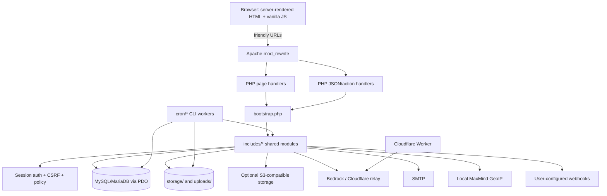
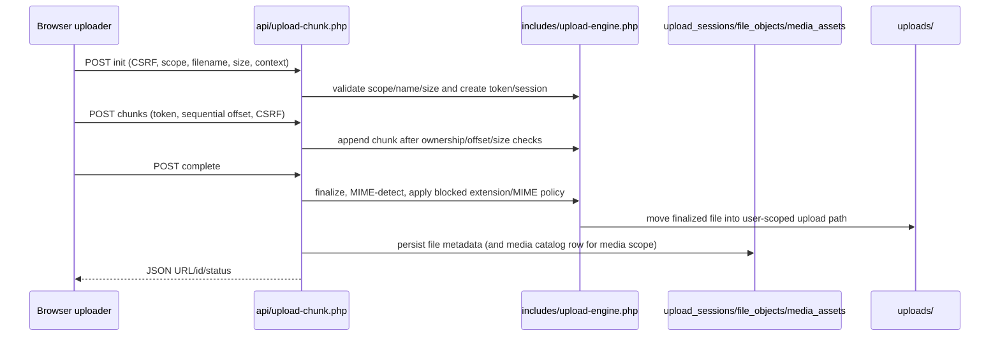
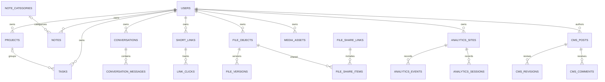

# PocketCat Codebase Analysis — Workspace Snapshot

**Analysis date:** 2026-10-23  
**Declared application version:** `19.73` (`VERSION`)  
**Project root inspected:** `/workspaces/create-two/pocketcat_work`  
**Git root:** `/workspaces/create-two`  
**Scope:** static architecture, data-flow, database, API, UX, security, reliability, deployment, and test review. This is a new report; the existing [`PROJECT_CODEBASE_ANALYSIS_V19.72.md`](./PROJECT_CODEBASE_ANALYSIS_V19.72.md) was preserved.

No application source, runtime configuration, database, or external service was modified or contacted. The ZIP in the parent directory was not opened.

## 1. Executive summary

PocketCat is a procedural PHP application with server-rendered pages, Apache rewrite routing, MySQL/MariaDB via PDO, and vanilla browser JavaScript/CSS. It combines accounts, projects/tasks/notes, short links, file and media storage/sharing, QR codes, AI chat, analytics, code snippets, support, and a built-in CMS/editor. Shared domain logic is concentrated in `includes/`, while page and API handlers are primarily PHP scripts. There is no Composer or npm manifest, framework bootstrap, or container definition in the inspected tree.

Before this report was added, the source tree contained **453 files**: 204 PHP files, 165 Markdown files, 38 JavaScript files, 19 CSS files, 15 SQL files, 2 TypeScript files, and 10 other/configuration files. The base schema contains the application’s MySQL tables; additional SQL migrations and runtime `ensure_*_schema()` functions also evolve the schema.

**Health assessment: mixed; live behavior unverified.** The eight configured PHP smoke-test scripts passed, and `make lint` passed across PHP files. The available PHP CLI is 8.4.15, but it lacks both `pdo_mysql` and `curl`; no browser, MySQL server, runtime storage state, or production environment was exercised. Therefore database migrations, request routing, file I/O, external APIs, and rendered UI have not been runtime-verified.

### Highest-priority findings

1. **High — Media Library uploads bypass the normal per-file and aggregate storage quota checks.** The chunked `media` scope has a separate 5 GiB minimum ceiling, then persists a `file_objects` row without calling `file_user_can_upload()`. Repeated authenticated uploads can exceed the configured plan quota and consume shared storage. Static evidence: `api/upload-chunk.php:27,37,56`; `includes/upload-engine.php:225-248`; `includes/files.php:79-89`.
2. **Medium — Client IP selection trusts forwarding headers without confirming a trusted proxy.** This affects IP-based policy, rate limits, analytics, and audit identity where the origin can be reached directly. Static evidence: `includes/functions.php:56-64`.
3. **Medium — The persistent rate limiter fails open on database errors.** Without APCu, `link_rate_limit()` returns `true` if its DB read/write fails, disabling the affected request limits during DB failure. Static evidence: `includes/links.php:65-68`.
4. **Medium — No application login throttling is visible in the login handler.** `auth/login.php` verifies credentials but does not call a rate limiter; external WAF protections are unknown.
5. **Low — Two rewrite rules target handler files absent from this source tree:** `api/storage-migrate.php` and `admin/storage/oauth.php`. Static evidence: `.htaccess:30,110`. The corresponding rewritten paths cannot reach an implementation in this snapshot.
6. **Low / deployment risk — Release markers are inconsistent.** `VERSION` says 19.73, changelogs exist through 19.78, and bootstrap’s schema marker is `19.68-schema-1`. This does not by itself prove a migration is missing, but complicates release and schema validation.

No finding was dynamically exploited. The security observations below are defensive static-review findings with stated confidence, not claims that a production system is compromised.

## 2. Workspace and inventory

### Git/workspace context

`git rev-parse --show-toplevel` identified `/workspaces/create-two` as the Git root. At inspection time, the root tracked only `README.md`; the project directory `pocketcat_work/` and a V19.79-named ZIP in the parent were untracked. The ZIP was not inspected. The analysis document is saved inside the project directory without replacing existing files.

### Directory map

```text
pocketcat_work/
├── root PHP, .htaccess, config.php, VERSION, Makefile, README and changelogs
├── about/ acceptable-use/ cookie-policy/ contact/ faq/ features/
│   how-it-works/ pages/ posts/ pricing/ privacy/ product/ security/ terms/
│   category/                         public pages and CMS-facing content
├── admin/                             admin pages; menus/, version-details/,
│   visual-engine/                     editor and governance screens
├── ai/ analytics/ billing/ code/      signed-in product pages
├── api/                               JSON/action handlers; admin/, analytics/,
│   menu/                              nested endpoint families
├── assets/css/ assets/js/             browser UI, interaction, editor and upload code
├── auth/                              login, signup, reset, logout
├── cron/                              CLI workers and scheduled maintenance
├── dashboard/                         user landing page
├── database/                          base MySQL schema and 14 SQL migrations
├── docs/                              operational/project docs, CMS page and seed script
├── file/ files/ media/ share/          file delivery, storage, media and sharing flows
│   share-management/ storage/          storage management and temporary directory
├── geoip/                              local GeoIP updater/docs; no MMDB database present
├── includes/                           shared domain, DB, auth, policy and integration code
├── install/                            first-run wizard and setup steps
├── integrations/cline/                 Cline/Bedrock source integration
├── links/ qr/                           short links, redirect/analytics and QR features
├── notes/ projects/ tasks/               workspace CRUD pages and API stubs
├── relay/cloudflare/                    Cloudflare Worker Bedrock relay
├── search/ settings/ support/            user configuration and support
├── tests/                               eight PHP smoke/regression scripts
└── uploads/                             local file/media/support/chunk directories and rules
```

Important root files:

| File | Responsibility |
|---|---|
| `index.php` | Public homepage and public service entry point. |
| `bootstrap.php` | Loads shared modules, configures session, install/maintenance gating, compatibility schema checks, and CMS scheduled publishing. |
| `config.php`, `.env.example` | Config defaults and environment-variable template. `config.php` reads the DB environment variables directly; no dotenv loader was found. |
| `.htaccess` | Apache rewrites, private-directory denies, and security headers. |
| `VERSION`, `README.md` | Declared release and high-level release context. |
| `Makefile` | `test`, `lint`, and `check` targets. |
| `database/schema.sql` | Base MySQL schema. |

### File classification and exclusions

- **Application:** 204 PHP scripts across pages, helpers, API handlers, installer, and CLI jobs.
- **Browser source:** 38 JavaScript, 2 TypeScript source files, and 19 CSS files under `assets/`.
- **Database:** 15 SQL files, including the base schema and migration series from V11.31 through V19.1.
- **Documentation:** 165 Markdown files, including architecture, deployment, QA, release notes, readiness docs, and the older V19.72 report.
- **Configuration/support:** `.htaccess` files, `.env.example`, `config/upload-hosting.ini`, `relay/cloudflare/wrangler.toml`, `VERSION`, and `Makefile`.
- **Tests:** eight files in `tests/`, all PHP smoke/regression scripts.
- **Runtime/generated:** `uploads/` and `storage/` are present as directory structures, but no live application dataset or generated DB state was accessed. The actual `GeoLite2-City.mmdb` is absent; only its README is present.
- **Dependencies:** no `composer.json`, Composer lockfile, `package.json`, JS lockfile, `vendor/`, `node_modules/`, Dockerfile, or Compose file was found.
- **Excluded from content analysis:** the parent-directory ZIP and bulky/binary/runtime files were not opened. There was no evidence of a local runtime database to inspect.

## 3. Technology and dependency matrix

| Component | Detected technology | Evidence | Version / implication |
|---|---|---|---|
| Server language | PHP | 204 `.php` files; `declare(strict_types=1)` appears in shared modules. | CLI observed as PHP 8.4.15; production PHP version unknown. |
| Backend design | Custom procedural PHP | `bootstrap.php`, `includes/`, page and endpoint scripts. | No framework or Composer autoloading observed. |
| Database | MySQL-compatible InnoDB | PDO MySQL DSN in `includes/database.php`; schema uses MySQL DDL, enums, indexes, and foreign keys. | Server/version unknown; this CLI lacks `pdo_mysql`. |
| Browser | Vanilla JavaScript and CSS | `assets/js/`, `assets/css/`; no framework manifest. | Browser behavior not exercised. |
| HTTP routing | Apache `mod_rewrite` and `.htaccess` | Friendly-path rules in root `.htaccess`. | Non-Apache hosting requires equivalent rewrites and access controls. |
| Build/test | Make + PHP CLI | `Makefile`. | `make test` and `make lint` ran locally. |
| File upload/storage | PHP filesystem, optional S3-compatible and cloud providers | `includes/upload-engine.php`, `includes/files.php`, `includes/cloud-storage.php`. | cURL absent in local PHP; storage credentials and cloud accounts untested. |
| AI | Amazon Bedrock-compatible API; optional Cloudflare Worker relay | `includes/ai.php`, `relay/cloudflare/worker.js`, `integrations/cline/`. | Credentials are configured through installer/admin/user settings; no external calls made. |
| Email | Custom SMTP client | `includes/mail.php`. | Requires outbound SMTP/TLS; untested. |
| GeoIP | Local MaxMind GeoLite2 reader/updater | `includes/maxmind-reader.php`, `geoip/`. | MMDB absent; no GeoIP lookup verified. |
| Runtime config | Environment + generated `storage/app-config.php` + DB settings | `config.php`, `includes/functions.php`, installer. | `.env.example` is not evidence that `.env` is loaded. |

Environment-variable names in `.env.example` include DB settings, app/environment URL fields, AWS/Bedrock and relay settings, SMTP settings, and a session-secure flag. In source, `config.php` directly consumes only `DB_HOST`, `DB_PORT`, `DB_NAME`, `DB_USER`, and `DB_PASSWORD`; app/service configuration is otherwise read from generated config or database settings. Session cookie security is derived from the request’s HTTPS server variable, not the `SESSION_SECURE` template key.

## 4. Architecture and module relationships



### Request lifecycle

1. Apache maps friendly URLs to PHP entry scripts; some API paths are rewritten with path/action parameters.
2. Most entry scripts include `bootstrap.php`. It loads shared helpers, sends no-store headers, starts the session, checks installation state, runs schema compatibility setup when its marker differs, invokes scheduled CMS publishing, and applies maintenance gating.
3. The handler performs authentication/permission/CSRF checks, validates request data, invokes shared domain functions, accesses the database through PDO, and renders HTML or JSON.
4. Browser scripts call JSON endpoints for interactive work and update the page. Cron scripts are CLI-oriented and handle scans, retention/cleanup, and queued work.

### Important modules

| Module | Responsibilities, inputs/outputs, dependencies, side effects |
|---|---|
| `bootstrap.php` | Common request setup. Includes `includes/functions.php` and the remaining shared modules; may create upload directories and alter schema; starts session and enforces installation/maintenance states. |
| `includes/functions.php` | App config, settings, escaping, client IP, secrets, platform data, shared helpers. Reads/writes `system_settings`, creates the application secret, and logs selected events. Broad module with cross-feature coupling. |
| `includes/database.php` | Lazy static PDO connection. Uses native prepares, exception mode and associative fetches. Requires MySQL credentials and `pdo_mysql`. |
| `includes/auth.php`, `includes/admin-auth.php`, `includes/csrf.php` | Session identity, login/logout, role/admin gates and CSRF token handling. |
| `includes/policy.php`, `includes/plan-catalog.php` | Plan limits, feature flags, testing mode, admin permissions, audit and network policy. Reads/writes policy JSON stored in DB settings. |
| `includes/files.php`, `includes/upload-engine.php`, `includes/cloud-storage.php` | Upload session protocol, file object metadata, quota/policy checks, download/share, local/S3/OAuth provider access. Filesystem, database, and outbound HTTP side effects. |
| `includes/links.php` | URL normalization, slug generation, redirection analytics, rate limiting, threat checks, and webhook delivery. |
| `includes/ai.php`, `includes/mail.php` | Bedrock request/credential selection and SMTP transport. Handles external network calls and sensitive configuration. |
| `includes/cms.php`, `includes/editor-suite.php`, `includes/menu-manager.php`, `includes/visual-engine.php` | CMS schema/content, revisions, menus, visual configuration, publishing/rollback. |
| `includes/analytics.php`, `includes/geo.php`, `includes/maxmind-reader.php` | Analytics collection/reporting, IP-derived fields, and local GeoIP lookup. |
| `api/` | JSON/action endpoints; request validation and ownership rules are implemented per handler, not through a uniform controller framework. |
| `admin/` | Server-rendered admin screens for users, plans, CMS, files, branding, security, and integration settings. |
| `cron/` | CLI-only maintenance, malware scanning, retention/cleanup, link click processing, scheduled CMS/visual publishing. |

**Architectural observations:** no framework-level service/repository separation; domain and HTTP concerns often share a file. `includes/functions.php`, `includes/files.php`, `includes/ai.php`, `api/files.php`, and `media/index.php` are large/broad modules. Base SQL, SQL migrations, runtime schema helpers, and per-request marker semantics are overlapping schema sources. No dynamic module loader/circular dependency analysis was attempted; shared modules are loaded with explicit `require`s.

## 5. Major business workflows and data flows

### Accounts and authentication

- `auth/signup.php`: POST + CSRF, validates email/password and creates an active Free user with `password_hash`; calls `login_user()` which regenerates session ID.
- `auth/login.php`: POST + CSRF, looks up active email/username and uses `password_verify`; successful login regenerates session ID and routes by role.
- `auth/forgot-password.php`: creates a random one-hour token, stores SHA-256 token hash, and uses SMTP; unknown users receive generic success text, though SMTP misconfiguration messaging differs for an existing account.
- `auth/reset-password.php`: hashes submitted token for lookup, checks expiry and active account, validates password, then updates the password and marks the reset used. Concurrent redemption/transaction behavior was not dynamically tested.
- `current_user()` queries the active user by session ID; `require_admin()` additionally requires role `admin` and admin view mode. Fine-grained admin permission checks are available through policy helpers.

### File Storage and Media Library



The regular `files` scope calls `file_user_can_upload()` at initialization; that helper compares the requested bytes and existing `file_objects` usage against plan limits. The `media` path instead has a distinct size guard and later persists a `file_objects` row directly. The latter misses both normal quota checks (finding SEC-01). Asynchronous CLI scan/cleanup jobs exist; actual scanner, local path permissions, cloud storage and download delivery were not exercised.

Failure handling includes CSRF/method checks, sequential chunk-offset enforcement, declared-size checks, file type blocklists, generic upload error responses with request IDs, and cleanup/scan workers. MIME checks are not a complete content-malware scan. Verify MIME/extension policy and resource limits against the exact production server.

### Short links

1. Authenticated UI/API submits destination, alias/options and CSRF or bearer token.
2. `api/create-link.php` / `api/links.php` validates HTTP(S), policy/plan options, quota, optional Safe Browsing checks, and persists to `short_links`.
3. `links/redirect.php` resolves the slug, checks active/expiry/password/geo routing, records or queues click analytics, and redirects or emits an interstitial.
4. Webhook notifications are sent synchronously for some events. Destination threat check is optional and explicitly fails open when unconfigured/unavailable; webhook destination checks require HTTPS and public DNS but have a DNS rebinding window.

### AI chat and attachments

`api/ai-chat.php` requires a signed-in user and CSRF on POST. It validates conversation ownership and attachment ownership, sends the latest 18 messages plus the current prompt/attachment metadata to `includes/ai.php`, then stores user/assistant messages and charges active time. Provider credentials may come from admin or per-user settings; secret values are encrypted using an application key. Bedrock/relay requests were not sent. Chat attachment uploads/read access are separate endpoints.

### Analytics, CMS, admin and task flows

- Public analytics collection accepts a site tracking key, derives visitor/request fields, and persists events; reporting and site management are authenticated and ownership-scoped.
- Admin CMS/editor flows manage posts/pages, taxonomies, comments, revisions and scheduled publishing. Review sanitizer, role and CSRF behavior for any content-writing change.
- `tasks/`, `projects/`, and `notes/` have separate list/create/edit/delete pages; rows are user-owned and plan limits are checked by shared helpers.
- Admin control plane updates plan flags, policy, users and network rules; actions use POST + CSRF and audit hooks in the reviewed control-plane handler.

## 6. Database and data model

### Connection and migration strategy

- MySQL DSN with `utf8mb4`; PDO exceptions, associative fetches and emulated prepares disabled.
- `database/schema.sql` defines the base schema. Fourteen additional `database/migration-*.sql` files describe incremental changes.
- Runtime helpers such as `ensure_platform_schema()`, `ensure_file_workspace_schema()`, `ensure_cms_schema()`, `ensure_code_schema()`, and analytics/editor/menu/QR helpers issue `CREATE TABLE` and `ALTER TABLE` statements.
- `bootstrap.php` runs these helpers when `storage/.schema-check-version` does not match the hard-coded marker. Failures are logged and the request continues, so partial/incomplete schema state is possible.
- No database connection, migration, seed, backup, restore, lock, or rollback was executed. Migration ordering and compatibility across deployed versions remain unverified.

### Main entities and relationships



Core table groups:

- **Identity/workspace:** `users`, `projects`, `tasks`, `notes`, `note_categories`, `milestones`, `activity_logs`.
- **Auth/config/policy:** `password_resets`, `system_settings`, `schema_version`, `policy_user_overrides`, `policy_audit_logs`, `admin_roles`, `user_admin_roles`, `admin_impersonation_logs`, `global_block_rules`.
- **AI/support:** `conversations`, `conversation_messages`, `chat_attachments`, `ai_settings`, `user_ai_settings`, `ai_usage_daily`, `email_settings`, `support_threads`, `support_messages`.
- **Links/API/QR:** `short_links`, `link_clicks`, `link_click_queue`, `link_api_tokens`, `link_webhooks`, `link_webhook_deliveries`, `link_rate_limits`, `api_request_logs`, `qr_designs`.
- **Files/media:** `file_objects`, `file_versions`, `upload_sessions`, `file_uploads`, `file_events`, `file_share_links`, `file_share_items`, `file_share_events`, `file_api_tokens`, `file_webhooks`, `file_abuse_blocks`, `file_abuse_history`, `media_assets`, `media_collections`, `media_collection_items`, `storage_connections`, `storage_audit_events`.
- **Analytics:** `analytics_sites`, `analytics_sessions`, `analytics_events`, `analytics_goals`.
- **CMS/docs/code:** `cms_posts`, categories/tags/join tables, revisions/comments/meta/preferences, `site_content`, `documentation_entries`, and code snippet/version/category/access tables.

`system_settings` is a key/value store containing string values and serialized policy/configuration. Ownership is represented primarily by `user_id` and foreign keys. Several high-volume event tables have time and owner indexes in the base schema. No query plan/cardinality review was possible; do not assume indexes are sufficient at production scale.

## 7. API and integration inventory

The API is implemented by the following 29 PHP handlers (friendly paths are mapped in `.htaccess`):

| Handler family | Files | Purpose / access pattern |
|---|---|---|
| Plans/admin | `api/plans.php`, `api/admin/plans.php`, `api/admin-links.php` | Public plan catalogue, admin plan mutation, authenticated link administration. |
| Admin editor | `api/admin/editor-suite/index.php`, `api/admin/visual-engine/index.php`, `api/menu/index.php`, `api/menu/save/index.php` | CMS/editor drafts and revisions, visual publish/rollback, menus; admin/CSRF controls. |
| AI/chat | `api/ai-action.php`, `api/ai-chat.php`, `api/chat-upload.php`, `api/chat-attachment.php` | Authenticated AI actions/chat and attachment upload/read. |
| Analytics | `api/analytics/collect.php`, `api/analytics/report.php`, `api/analytics/site.php` | Public tracking collection; authenticated reports/site configuration. |
| Files/media | `api/files.php`, `api/upload-chunk.php`, `api/media.php`, `api/media-share.php`, `api/share-management.php` | Ownership/token-protected file operations, chunk upload, media catalog, sharing and analytics. |
| Links | `api/create-link.php`, `api/links.php`, `api/link-events.php` | Session-based link creation, bearer-token API, events and link operations. |
| Other product APIs | `api/code.php`, `api/growth.php`, `api/qr-design.php`, `api/secret.php`, `api/stats.php`, `api/support-chat.php`, `api/support.php` | Code, public chart/stats, QR settings, secret/config controls, support operations. |

Notable request controls: the file API checks CSRF for session POSTs and uses bearer tokens for API mode; the chunk API requires login, POST and CSRF; media mutations require login and CSRF; the public analytics collector uses a site key; public stats/plans are intentionally unauthenticated. Exact methods, validation, and ownership are handler-specific.

### External boundaries

| Integration | Code/config | Data crossing boundary | Static concerns |
|---|---|---|---|
| Bedrock | `includes/ai.php`, `settings/ai.php`, `admin/ai.php` | Prompts/history and AI configuration | No provider calls; timeout/error paths and account billing unverified. |
| Cloudflare Worker relay | `relay/cloudflare/worker.js`, `relay/cloudflare/wrangler.toml` | AI request and shared relay token header | Worker secret is server-side; worker CORS is `*`; callers should not expose the token to browsers. |
| SMTP | `includes/mail.php`, admin/installer settings | Password-reset/support email | Custom SMTP protocol implementation; no delivery test. |
| S3/OAuth storage | `includes/files.php`, `includes/cloud-storage.php` | File bytes, metadata, OAuth tokens | HTTPS verification enabled in cloud HTTP helper; no provider tests. |
| Webhooks | `includes/links.php`, `includes/files.php` | Event payload and signatures | HTTPS/public-IP checks and redirects disabled, but DNS is not pinned between validation and request. |
| Malware scanner | `cron/file_scan.php` | File metadata and download URL to configured scanner | CLI-only static inspection; scanner auth/SSRF policy and response contract untested. |
| GeoIP | `geoip/update.php`, local MMDB reader | IP lookup against local database | Database file absent; updater network path not run. |

### Dangling rewrite targets

- `.htaccess:30` routes `/api/storage-migrate/` to `api/storage-migrate.php`, which is absent.
- `.htaccess:110` routes `/admin/storage/oauth/` to `admin/storage/oauth.php`, which is absent.

No matching handler file exists in the inspected tree. Confirm whether those endpoints are intentionally retired, supplied externally, or should be restored.

## 8. Authentication and authorization

- Sessions are started in `bootstrap.php` with `HttpOnly`, `SameSite=Lax`, root path, and `Secure` only when `$_SERVER['HTTPS']` is set and not `off`.
- Login and signup use CSRF checks; passwords use `password_hash()`/`password_verify()`; login regenerates the session ID.
- `current_user()` reloads an active user by session ID; `require_admin()` requires an admin role and admin-view state. `require_super_admin()` also requires wildcard policy permission.
- File, media, link, conversation, and analytics ownership checks are visible in primary handlers; IDOR regression tests should cover each resource/action.
- Reset tokens are random and stored as hashes with expiry; reset updates are not wrapped in an explicit transaction in the reviewed handler.
- No built-in login attempt throttle is visible in `auth/login.php`. Verify upstream WAF/reverse-proxy protections.
- Behind TLS-terminating proxies, verify `HTTPS` detection and `Secure` cookie behavior from the actual deployment topology.

## 9. Defensive security review

Severity/confidence describe static evidence and plausible impact, not live exploit testing.

| ID | Severity / confidence | Location | Evidence, impact and recommended action |
|---|---|---|---|
| SEC-01 | **High / 9 of 10** | `api/upload-chunk.php:27,37,56`; `includes/upload-engine.php:225-248`; `includes/files.php:79-89` | The ordinary `files` scope checks `file_user_can_upload()`. The `media` scope does not; its condition allows a per-file size up to at least 5 GiB even when the plan cap is lower, and `upload_persist_result()` inserts directly into `file_objects`/`media_assets`. Repeated authenticated uploads can exceed both per-file and aggregate plan quotas, creating shared-storage exhaustion. **Remediation:** apply the common per-file/aggregate quota check atomically at media initialization and final persistence; test Free/Basic/Premium boundaries and concurrent uploads. |
| SEC-02 | **Medium / 8 of 10** | `includes/functions.php:56-64` | `client_ip()` accepts `CF-Connecting-IP`, `X-Forwarded-For`, and `X-Real-IP` without validating that `REMOTE_ADDR` belongs to a trusted proxy. Direct-origin callers can spoof the identity used by IP blocks, rate limits, logs and analytics. **Remediation:** only honor configured trusted proxy addresses and parse the proxy chain according to deployment; test spoofed headers from trusted and untrusted peers. |
| SEC-03 | **Medium / 8 of 10** | `includes/links.php:65-68`; `includes/policy.php:163` | When APCu is unavailable and DB rate-limit storage throws, the catch returns `true`, allowing requests. Abuse controls can silently stop during a DB fault. **Remediation:** fail closed or use an independent limiter for sensitive operations, emit a structured alert, and test DB failure behavior. |
| SEC-04 | **Medium / 7 of 10** | `auth/login.php` (POST handler) | Credential checks have CSRF protection and generic invalid-credential text, but no local per-account/IP throttling is visible. Online password guessing risk depends on external controls not available here. **Remediation:** add bounded rate limiting/backoff and tests for repeated failures without account enumeration. |
| SEC-05 | **Medium / 6 of 10** | `includes/functions.php:68-84`; `includes/links.php:79`; `includes/files.php:88,195` | Webhook validation resolves hostnames and rejects private/reserved addresses, but delivery later connects by hostname without pinning that validated address. DNS rebinding can invalidate the check between validation and cURL use. Redirects and non-HTTPS schemes are disabled, which are positive controls. **Remediation:** resolve and pin validated public IPs for delivery while preserving TLS hostname verification; test rebinding/private-address resolution. |
| SEC-06 | **Low / 9 of 10** | `.htaccess:30,110` | Rewrite destinations for storage migration and cloud OAuth point to missing handler files. Requests fail despite advertised rewrite routes. **Remediation:** remove obsolete rewrites or provide handlers; add a route-target consistency check. |
| SEC-07 | **Low / 8 of 10** | `bootstrap.php:7`; `.env.example` | Session `Secure` depends on the PHP HTTPS server variable, not the template’s `SESSION_SECURE` value. TLS-terminating proxy deployments may issue a cookie without `Secure` if the origin does not report HTTPS. **Remediation:** configure trusted proxy HTTPS detection or an explicit secure-session setting; verify on deployed topology. |

Positive controls observed: PDO native prepares, HTML escaping via `e()`, CSRF helpers, password hashing, session ID regeneration, random reset/share tokens, AES-GCM secret encryption, upload-scoped user directories, chunk offset/size checks, local upload `.htaccess` rules, and restrictive webhook redirect/protocol options.

No dependency vulnerability scanner was run because no package manifest/lockfile was present. The deployment docs include environment-specific identifiers; review/redact them before public distribution. No secret values are reproduced in this report.

## 10. Bugs, edge cases, and reliability

### Confirmed static defects / risks

- **BEH-01 — media quota enforcement gap:** described as SEC-01; affects plan enforcement and storage capacity.
- **BEH-02 — dangling rewrite routes:** `.htaccess:30,110` target files absent from the snapshot.
- **BEH-03 — schema marker drift:** declared version is 19.73 but bootstrap schema marker remains `19.68-schema-1`. Current compatibility helpers may still repair schema, but marker changes and recent schema requirements are not aligned transparently.
- **BEH-04 — migration errors may be hidden:** bootstrap and several schema helpers catch/log broad exceptions and allow request execution to continue, risking partial feature availability.
- **BEH-05 — app-secret persistence failure can break decryption:** `app_secret()` creates a random key, suppresses write/chmod errors, and returns the key even if it was not persisted. If storage is unwritable, later requests may generate a different key and fail to decrypt stored secrets. Verify storage permissions during setup and report persistence errors explicitly.
- **BEH-06 — request-driven schema setup:** the first web request after marker change performs DDL. Concurrent first requests/deployments and partial DDL recovery are not tested.
- **BEH-07 — version/release inconsistency:** `VERSION` is 19.73; V19.78 changelogs are present; the parent has a V19.79-named ZIP that was deliberately not inspected. This report describes the source tree, not that ZIP or a production deployment.

Other review targets requiring runtime checks: upload cleanup after interruption, scanner timeouts, mixed local/cloud storage failure, duplicate slug creation under concurrency, reset-token concurrent redemption, backup/recovery, and event retention.

## 11. Frontend and user experience

- Public and authenticated pages use server-rendered PHP templates. Shared header/footer/navigation are in `includes/`.
- Browser behavior is grouped in `assets/js/` and responsive styles in `assets/css/`; dedicated scripts exist for AI, editor, file upload/share, media, analytics, links, QR, menu, visual engine and admin policy.
- Major journeys map to:
  - Sign-up/login: `auth/`, `includes/auth.php`, `includes/csrf.php`.
  - Tasks/projects/notes: their directory pages and `api/*` handlers.
  - File management: `files/`, `media/`, `api/files.php`, `api/media.php`, `api/upload-chunk.php`, upload scripts.
  - Link creation/redirect: `links/`, `api/create-link.php`, `api/links.php`, `links/redirect.php`.
  - AI chat: `ai/`, `api/ai-chat.php`, `api/chat-upload.php`, `includes/ai.php`.
  - Admin CMS/settings: `admin/`, `api/admin/*`, shared CMS/editor/policy modules.
- Forms and APIs include empty/invalid/error feedback in many flows; static review cannot establish actual visual states or assistive accessibility.
- No browser, viewport, keyboard, screen reader, or JavaScript console test was available. UI conclusions are static only.

## 12. Performance and scalability observations

These are static hypotheses, not measured results:

- Bootstrap eagerly includes many modules; benchmark request startup before considering lazy loading.
- `setting()` performs a DB query per setting read without an evident request-local value cache. Admin pages and public metrics may generate many small queries.
- Public stats/growth and several client scripts poll frequently; verify request volume and DB cost under real concurrent traffic.
- Rate limits fall back to DB persistence when APCu is absent; the table requires cleanup and the error path currently fails open.
- Analytics and click/event tables can grow continuously; retention cleanup covers selected tables, but confirm every high-volume table has policy, index, and worker coverage.
- Uploads are chunked and stream-like, but aggregate quotas must be enforced consistently. Storage capacity, archive processing, and large downloads require production resource-limit testing.
- Webhook delivery and some integrations run synchronously; slow external destinations can add request/worker latency.

## 13. Code quality and maintainability

- Procedural PHP is consistent throughout, but HTTP routing, policy, validation, DB writes, and rendering often coexist in the same file.
- Large central modules (`includes/functions.php`, `includes/files.php`, `includes/ai.php`, `api/files.php`, `media/index.php`) are higher-risk change surfaces.
- Several PHP/JavaScript files use compressed, long-line code, increasing review and diagnostic cost.
- Configuration and policy values are often typed/validated at runtime from string/JSON settings.
- Numerous historical changelogs and architecture notes are useful, but current `VERSION`, changelog names, schema marker, and route implementation should be reconciled.
- Tests are executable PHP smoke scripts rather than a framework-managed unit/integration/E2E suite.
- No unused file should be removed based only on static search; rewrites, dynamic loading, externally invoked cron jobs, and deployed clients may reference it.

## 14. Testing strategy and observed results

### Commands actually run

| Command | Observed result |
|---|---|
| `make test` | Passed all eight test scripts: policy, plan limits, plan catalog, plan catalog UI, webhook target, Bedrock server-side credential handling, Activate/readiness, and site branding. |
| `make lint` | Passed; PHP syntax checks reported no errors. The Makefile recursively lints PHP files. |
| `php -v` | PHP CLI 8.4.15. |
| `php -m` | PDO, SQLite, OpenSSL and fileinfo available; `pdo_mysql` and `curl` absent. |

Xdebug printed a debugger-connection warning during smoke tests; test assertions still passed. Tests are static/smoke checks and do not establish that MySQL-backed flows work.

### Highest-priority missing coverage

| Area | Regression cases to add |
|---|---|
| File/media quota | Free/Basic/Premium per-file and aggregate limit, media-scope checks, concurrent uploads, retry/finalize race, exact 5 GiB boundary. |
| Auth | Rate limit/backoff, reset expiry/one-time use under concurrency, session cookie behind proxy, disabled account, CSRF. |
| Authorization | Cross-user access for every file, share, link, conversation, media, analytics site, note/project/task operation. |
| Upload safety | MIME/extension mismatch, oversized declared size, offset replay/order, interruption/cleanup, writable-directory failures, scan fail/timeout. |
| Webhooks | DNS rebinding/pinning, private IPv4/IPv6, redirects, timeouts, failures, retries/idempotency and event-secret handling. |
| Schema | Fresh install, each supported upgrade path, repeat run, concurrent bootstrap, partial DDL failure, restore from backup. |
| Routing | Ensure every `.htaccess` PHP rewrite destination exists and maps to expected method/handler. |
| Browser/E2E | Signup, dashboard, upload/share/download, link create/redirect, AI error states, admin changes, responsive/accessibility, console/network failures. |
| External services | Bedrock timeout/429/5xx/invalid JSON, SMTP TLS/auth failures, S3 partial failure, scanner response validation, GeoIP missing DB. |
| Performance | Upload concurrency and disk saturation; analytics retention; DB query plans; polling load; webhook latency. |

## 15. Local development and deployment requirements

Evidence indicates the following setup components; exact production versions/permissions remain unknown:

1. PHP 8.x with PDO MySQL, cURL, OpenSSL and fileinfo enabled for relevant features. This analysis runtime lacks PDO MySQL and cURL.
2. MySQL/MariaDB with a disposable development database. Do not run installer/schema steps against production during analysis.
3. Apache with `mod_rewrite` and `.htaccess` overrides, or equivalent explicit routing/security rules.
4. Writable, non-public `storage/` and appropriate upload directories; verify the private-key and app-secret persistence paths.
5. Installer-driven DB setup, base `database/schema.sql`, and compatibility/migration path. The installer creates runtime config and installed marker; exact upgrade sequencing must be verified before deployment.
6. Optional Bedrock/relay, SMTP, storage provider/OAuth, malware scanner, and local GeoIP assets.
7. Cron scheduling for the CLI scripts under `cron/`, including scan/cleanup and scheduled publishing. Exact cadence is host/product policy.
8. Run `make check` in an environment with required PHP extensions; follow with isolated DB integration, browser, and external-service tests.

No local server was started; no database was created or modified; no install wizard or external integration was invoked. Environment variable values are intentionally omitted.

## 16. Prioritized remediation roadmap

1. **P0:** Enforce normal per-file and aggregate quota policy for Media Library uploads; make the quota check safe against concurrent uploads and verify stored-byte accounting.
2. **P1:** Configure trusted reverse-proxy IPs, harden login throttling, and make rate limiting failure behavior explicit/observable.
3. **P1:** Pin validated webhook destinations or otherwise prevent DNS rebinding; test IPv4 and IPv6 and preserve TLS hostname verification.
4. **P1:** Resolve the two missing rewrite destinations; add a static route consistency test.
5. **P1:** Make app-secret persistence failure explicit and test encryption/decryption across separate requests.
6. **P2:** Move DDL to a controlled migration/release step where practical; define one schema version source and test fresh/upgrade/retry paths.
7. **P2:** Reconcile release number, changelog, asset cache keys and schema marker; review older deployment docs for stale identifiers before public distribution.
8. **P2:** Profile DB settings reads, API polling and synchronous external calls with realistic traffic before optimizing.
9. **P2:** Add automated browser and DB-backed integration coverage to the existing smoke/lint workflow.

## 17. Unverified areas and limitations

- No MySQL/MariaDB runtime connection: local PHP lacks `pdo_mysql`; schema content was read statically only.
- No cURL extension locally; Bedrock, SMTP, cloud storage, webhook, scanner, and GeoIP network behavior were not tested.
- No browser/Playwright session; frontend layout, accessibility and JS behavior remain static-only.
- No production endpoint or paid/external service was contacted.
- The parent V19.79-named ZIP was not opened; its contents/version are unknown.
- Runtime credentials, installed database, storage files, permissions, cron configuration, and hosting rewrite behavior are unknown.
- No dependency audit was possible because package manifests/lockfiles were not found.
- Static search cannot prove a file is unused or that no WAF/proxy mitigates a finding.

## 18. Future change-readiness checklist

- [ ] Confirm target is this source tree and reconcile declared `VERSION`, changelog, schema marker, and deployment artifact.
- [ ] Trace `.htaccess` route to handler, then follow browser caller, auth/CSRF, shared helper, DB table, and side effects.
- [ ] Recheck ownership and plan enforcement at both initialization and final persistence for uploads/resources.
- [ ] Review base schema, all relevant migrations, runtime `ensure_*_schema()` functions, and install/upgrade paths.
- [ ] Add tests for normal, invalid, missing, unauthorized, boundary, concurrency, and recovery cases.
- [ ] Run `make check`; then test with MySQL PDO/cURL, a disposable DB, local HTTP/browser tooling, and mocked or sandboxed integrations.
- [ ] Review failure logging, quotas, cleanup, retention and rollback behavior.
- [ ] Preserve the existing V19.72 report and avoid copying deployment identifiers or secret values into future docs.

### Change-impact map

| Feature | Inspect first | Likely related schema/tests |
|---|---|---|
| Authentication/admin | `auth/*`, `includes/auth.php`, `includes/admin-auth.php`, `includes/csrf.php`, `includes/policy.php` | `users`, `password_resets`, admin roles; add auth/CSRF/ownership tests. |
| Files/media | `api/files.php`, `api/upload-chunk.php`, `api/media.php`, `includes/files.php`, `includes/upload-engine.php`, UI upload scripts | `file_objects`, `upload_sessions`, `media_assets`, shares/versions; quota, path, scan, cleanup tests. |
| Short links | `api/create-link.php`, `api/links.php`, `links/redirect.php`, `includes/links.php` | `short_links`, clicks, tokens, webhooks; auth, SSRF, quota, redirect tests. |
| AI | `api/ai-chat.php`, `includes/ai.php`, settings/admin AI pages, relay Worker | conversation, attachment, usage, secret settings; timeout, provider, secret-isolation tests. |
| Analytics | `api/analytics/*`, `includes/analytics.php`, `analytics/` | analytics sites/sessions/events/goals; ownership, consent, retention, payload tests. |
| CMS/editor | `admin/*`, `api/admin/*`, `includes/cms.php`, editor/menu/visual helpers | CMS/revision/menu tables; sanitization, role, CSRF, publish/rollback tests. |
| Release/setup | `install/*`, `database/*`, `bootstrap.php`, `.htaccess`, deployment docs | fresh/upgrade schema, route-target validation, secret persistence and rollback. |
