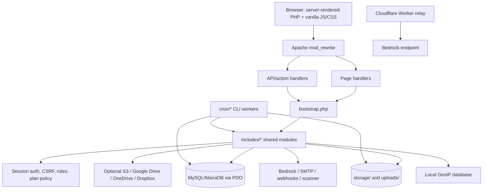
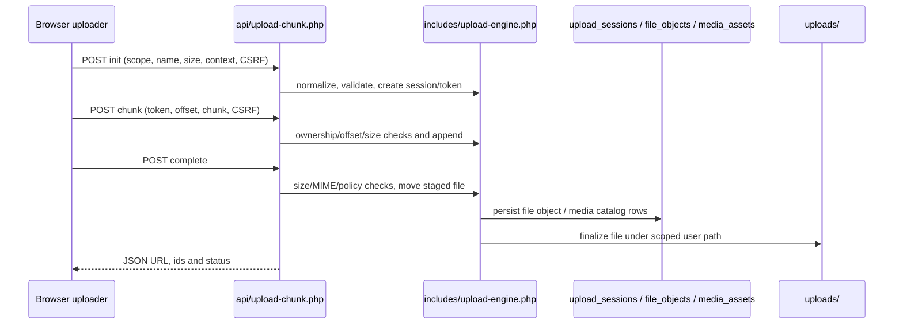
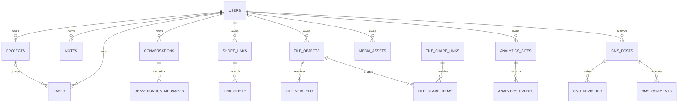

# PocketCat Codebase Analysis — Workspace Snapshot

**Analysis date:** 2026-10-25  
**Project root:** `/workspaces/Create-new/pocketcat_work`  
**Git root:** `/workspaces/Create-new`  
**Declared application version:** `19.73` (`VERSION`)  
**Review type:** Read-only static architecture, data-flow, reliability, UX, and defensive security analysis.

This report supplements rather than replaces [`PROJECT_CODEBASE_ANALYSIS_V19.73.md`](./PROJECT_CODEBASE_ANALYSIS_V19.73.md) and the V19.72 report. The older reports were preserved. This analysis inspected the current project source directly, ran the configured source-level check target, and used a separate read-only security review. No application code, database, runtime configuration, or external service was changed or contacted.

## 1. Executive summary

PocketCat is a multi-feature web application implemented primarily in procedural PHP. It uses server-rendered pages, Apache rewrite rules, PDO/MySQL, shared domain helpers under `includes/`, and hand-written JavaScript/CSS for browser interactions. Its feature set includes accounts and workspaces, tasks/projects/notes, short links and analytics, upload/media/file sharing, AI chat, support, CMS/editor tools, QR codes, policy/plan administration, optional cloud storage, and cron-maintained work.

**Health assessment: substantial feature surface, mixed maintainability, incomplete release/schema alignment, and a confirmed high-severity uploaded-content risk.** The configured `make check` passed: 11 PHP smoke/regression scripts and PHP syntax checks for 211 PHP files. The current host PHP CLI is 8.4.15 and has PDO SQLite, cURL, OpenSSL, fileinfo, and mbstring; it does not have `pdo_mysql`. The isolated QA database and web containers used in the previous live-QA task were removed, so MySQL-backed and browser behavior was not re-run for this analysis. Earlier live checks and their evidence remain documented in the local QA files, but they are historical test evidence, not a test run performed here.

### Highest-priority conclusions

1. **High — active content uploaded by users may be served inline from the application origin.** The file stream and support attachment handlers use stored/detected MIME types and inline disposition paths; `.html`/`text/html` is not in the default upload blacklist. See [Security review](#9-defensive-security-review).
2. **Low / functional routing risk — two Apache rewrites point at missing handler files:** `api/storage-migrate.php` and `admin/storage/oauth.php`. The latter is also referenced by the cloud-storage OAuth callback URI helper.
3. **Release/schema tracking is inconsistent:** `VERSION` says 19.73; V19.74–V19.78 changelogs exist; bootstrap uses `19.68-schema-1` as its runtime schema marker. This is a coordination/verification risk, not proof of a missing migration.
4. **Schema changes have multiple owners:** 75 `CREATE TABLE` declarations in the base schema, 14 numbered SQL migrations, and runtime `ensure_*_schema()` helpers. Bootstrap can run DDL on an ordinary request and catches/logs broad failures before continuing.
5. **The parent Git repository does not track the application source tree as individual files.** The project directory is untracked in `/workspaces/Create-new`; recent repository publication was a ZIP-only archive commit. This weakens source review, blame, and change traceability unless the packaging model is intentional.

No production system was probed or exploited. Static findings are evidence-based but do not establish whether deployment-specific controls mitigate the risk.

## 2. Workspace inventory

### Directory map

```text
pocketcat_work/
├── root PHP entry points, .htaccess, config.php, bootstrap.php, VERSION, Makefile
├── public pages: about/, acceptable-use/, contact/, cookie-policy/, faq/,
│   features/, how-it-works/, pages/, posts/, pricing/, privacy/, product/,
│   security/, terms/, category/
├── auth/                  login, registration, logout, password recovery
├── dashboard/ tasks/ projects/ notes/   authenticated workspace pages
├── admin/                 administrator and CMS screens, subfolders for menus,
│   visual-engine/, and version-details/
├── api/                   JSON/action endpoints, nested admin/, analytics/, menu/
├── includes/              shared application/domain/auth/database/integration logic
├── database/              base MySQL schema plus 14 numbered SQL migrations
├── install/               first-run wizard and setup steps
├── assets/css/ assets/js/ browser styles, interactions, uploaders, editors
├── files/ file/ media/ share/ share-management/ uploads/
│                          file catalog, streaming, Media Library and storage
├── links/ qr/             redirects, link creation/reporting, QR experiences
├── ai/ analytics/ billing/ code/ support/ settings/
│                          signed-in product and service configuration features
├── cron/                  CLI maintenance, scanning, cleanup, event and publishing jobs
├── config/                PHP upload/runtime tuning
├── geoip/ integrations/cline/ relay/
│                          local GeoIP, Cline integration, Cloudflare Worker relay
├── docs/                  architecture/deployment/QA material and browser evidence
├── tests/                 11 configured smoke/regression tests plus integration-mock runner
└── storage/                runtime-only config, secret, install lock and markers
```

### File-type inventory

The count below is based on regular files outside `storage/` and `uploads/` and excludes `.git`, `vendor`, and `node_modules`. It includes documentation and QA evidence:

| Type | Count | Role |
|---|---:|---|
| PHP | 211 | Pages, handlers, shared modules, installer, cron and tests |
| Markdown | 168 | Architecture, deployment, changelog, QA and operating documentation |
| JavaScript | 38 | Browser behavior and Cloudflare Worker source |
| CSS | 19 | Application layouts, responsive styles, editors and feature styling |
| SQL | 15 | One base schema and 14 numbered migrations |
| TypeScript | 2 | Source files; no package/build manifest was found |
| JPG / PNG | 280 / 36 | Stored screenshots and visual evidence in docs |
| WebM / JSON | 3 / 3 | Browser recordings and machine-readable QA results |
| Other | 7 | `.htaccess`, `.env.example`, TOML, INI, VERSION and extensionless README |

Top-level areas with the largest file counts are `docs/` (332 files, including visual evidence), `admin/` (49), `assets/` (56 across CSS/JS), `includes/` (35), `api/` (29), `database/` (15), and `tests/` (12).

**Runtime data limitation:** host permissions denied recursive reads of `storage/` and several `uploads/` subdirectories. They were not opened or enumerated from the host. Prior cleanup evidence established that the temporary test database/containers and synthetic uploads were removed; those directories should still be checked through the deployment owner’s privileged runtime access before any operational migration or backup. No secret values were read.

### Important files

| File | Responsibility |
|---|---|
| `index.php` | Public application entry/homepage. |
| `bootstrap.php` | Shared include loading, session setup, install/maintenance gates, schema compatibility setup, scheduled CMS hook. |
| `config.php`, `.env.example` | Runtime configuration defaults and a variable-name template. No dotenv loader was found; `.env.example` alone is not loaded. |
| `.htaccess` | Apache friendly routes, sensitive path denies, and response headers. |
| `database/schema.sql` | Initial MySQL/InnoDB schema. |
| `Makefile` | `test`, `lint`, `check`, and integration-mock targets. |
| `VERSION` | Declared application version, currently `19.73`. |
| `includes/functions.php` | Common escaping/config/settings, IP, secret, event, URL and presentation helpers. |
| `includes/policy.php`, `includes/plan-catalog.php` | Plan entitlements, policy flags, quotas and admin permissions. |
| `includes/files.php`, `includes/upload-engine.php` | File policy, upload sessions, storage abstraction and file lifecycle. |
| `api/files.php`, `api/upload-chunk.php`, `api/media.php` | File, chunk-upload and Media Library operations. |

### Dependency/tooling inventory

No `composer.json`, Composer lockfile, `package.json`, npm lockfile, Dockerfile, Compose file, `.github/workflows/` tree, `vendor/`, or `node_modules/` was found in the project. `Makefile` is the visible project test/lint entry point. Third-party runtime services and browser libraries therefore need to be inferred from code, configuration, and deployment documents rather than a package lock.

## 3. Technology matrix

| Component | Observed technology | Evidence | Operational implication |
|---|---|---|---|
| Backend | PHP 8.x, procedural/server-rendered | 211 PHP files; explicit `require` calls | No framework router, dependency injection container, or Composer autoloading found. |
| Database | MySQL/MariaDB via PDO, InnoDB, utf8mb4 | `includes/database.php`, `database/schema.sql` | Requires `pdo_mysql`; current host CLI lacks this extension. |
| Frontend | Vanilla JS, CSS, limited TS sources | `assets/js/`, `assets/css/`; no frontend manifest | Script loading and feature ownership are page/template dependent. |
| HTTP routing | Apache `mod_rewrite` and `.htaccess` | Root rewrite rules | Other hosts must faithfully reproduce rewrites, access restrictions, and headers. |
| Configuration | Environment variables, generated PHP config, database settings | `config.php`, `storage/app-config.php`, `system_settings` usage | `.env.example` is a template; no dotenv loader was observed. |
| Email | Custom SMTP client | `includes/mail.php` | Requires TLS-capable outbound sockets and SMTP configuration. |
| AI | Amazon Bedrock-compatible API; optional Worker relay | `includes/ai.php`, `relay/cloudflare/worker.js` | Requires server-side keys/tokens, cURL and correct upstream model/mode. |
| Object storage | Local filesystem, S3-compatible, Google Drive, OneDrive, Dropbox | `includes/files.php`, `includes/cloud-storage.php` | Provider credentials, TLS, OAuth redirect configuration, and local permissions must be set. |
| GeoIP | Local MaxMind-style reader/updater | `includes/maxmind-reader.php`, `geoip/` | GeoIP data file and scheduled update are deployment-managed. |
| Tests | PHP scripts invoked by Make | `Makefile`, `tests/` | No PHPUnit/Pest or browser test runner configured in this tree. |
| Worker | Cloudflare Worker JavaScript | `relay/cloudflare/worker.js`, `wrangler.toml` | Deploy separately; Worker secrets must be provisioned out-of-band. |

### Environment variable names

The template names cover `APP_NAME`, `APP_URL`, `APP_ENV`; `DB_HOST`, `DB_PORT`, `DB_NAME`, `DB_USER`, `DB_PASSWORD`; AWS/Bedrock/relay variables (`AWS_*`, `BEDROCK_*`); SMTP variables (`SMTP_*`); and `SESSION_SECURE`, `SESSION_IDLE_TIMEOUT`, and `BILLING_SANDBOX`. The active `config.php` directly consumes the DB variables; the application also reads settings from generated runtime config and `system_settings`. Session `Secure` cookie behavior in bootstrap is inferred from the request’s HTTPS server variable rather than the template’s `SESSION_SECURE` key. No credential values are reproduced here.

## 4. Architecture and module relationships



### Request lifecycle

1. Apache rewrites friendly paths to PHP page or API scripts.
2. Most scripts require `bootstrap.php`; it loads the shared modules, sends no-store headers for web requests, starts the session, enforces idle timeout, checks installation state, may run schema helpers, invokes scheduled CMS publishing, and applies maintenance mode.
3. Handlers perform authentication, CSRF, plan/ownership checks, validation, persistence and external side effects. Most return rendered HTML; APIs return JSON using per-endpoint conventions.
4. Deferred browser scripts submit forms or fetch APIs and update parts of the page.
5. CLI cron programs perform asynchronous-ish scanning, cleanup, click processing and scheduled publication; they are not a centralized job framework.

### Module responsibilities and coupling

| Module | Responsibility and side effects |
|---|---|
| `includes/functions.php` | Configuration/settings reads/writes, escaping, app secret encryption, IP extraction, URL helpers, event logging and common response helpers. It is a central dependency and broad coupling point. |
| `includes/database.php` | Lazy static PDO connection with exception mode, associative fetches and emulated prepares disabled. |
| `includes/auth.php`, `includes/admin-auth.php`, `includes/csrf.php` | Session identity, session renewal/idle timeout, role/admin-view gates, CSRF token issue/validation. |
| `includes/policy.php`, `includes/plan-catalog.php` | Feature flags, limits, admin permission checks, testing mode and plan catalogue decisions. |
| `includes/files.php`, `includes/upload-engine.php`, `includes/cloud-storage.php` | Upload sessions, file metadata, storage drivers, share/download policies, cloud OAuth/HTTP. Writes DB/filesystem and calls providers. |
| `includes/links.php` | Destination normalization, slug creation, redirect analytics, throttling, threat lookup and signed webhooks. |
| `includes/ai.php`, `includes/mail.php` | Bedrock transport/credential handling, AI usage accounting and custom SMTP. |
| `includes/cms.php`, `includes/editor-suite.php`, `includes/menu-manager.php`, `includes/visual-engine.php` | CMS content, revisions/taxonomies, menu state, visual editing and scheduling. |
| `includes/analytics.php`, `includes/geo.php`, `includes/maxmind-reader.php` | Analytics schema/queries, request telemetry and local geolocation. |
| `api/` | Per-handler JSON endpoints. Validation/auth/ownership logic is not centralized in a controller layer. |
| `admin/` | Server-rendered configuration and governance screens, including CMS, policy, users and integrations. |
| `cron/` | CLI jobs for CMS scheduling, file scan/cleanup, abandoned uploads, click queue and visual publishing. |

No framework-level repository/service split exists. HTTP handling, SQL, business rules and HTML often share page files. Larger/high-coupling modules include `includes/functions.php`, `includes/files.php`, `includes/ai.php`, `api/files.php`, `api/media.php`, `includes/cms.php`, and `media/index.php`. These are high-risk change surfaces. No module graph/static dependency tool was configured.

## 5. Business workflows and data flow

### Accounts and sessions

- Signup: `auth/signup.php` validates CSRF, email, matching password length and registration plan; stores a password hash in `users`, then calls `login_user()` (session ID regeneration).
- Login: `auth/login.php` verifies an active email/username and password; admin role routes to admin, others to dashboard. Invalid responses use generic sign-in text. No local attempt throttle is visible in the handler; deployment-level protection is unknown.
- Password recovery: `auth/forgot-password.php` issues a random token, persists its SHA-256 hash and sends mail; reset validates hash/expiry/active user, updates password and marks token used. Concurrent token redemption and SMTP failure behavior need integration tests.
- Authorization: `current_user()` reloads active user from DB. `require_admin()` requires `role=admin` and admin-view mode; fine-grained permission helpers exist for some admin operations. Page/API-level enforcement varies by handler.

### Workspace CRUD

`tasks/`, `projects/`, and `notes/` render server-side pages and write through prepared SQL statements. Task and project creation check plan limits; row ownership is represented by `user_id`. The visible `tasks/api.php`, `projects/api.php`, and `notes/api.php` files are minimal responses rather than the primary CRUD implementation. Actual CRUD is in separate page endpoints. Existing plan checks and user scoping should be preserved when moving logic to APIs.

### File and Media upload



The normal `files` scope checks `file_user_can_upload()` for per-file and aggregate storage limits. The `media` scope runs a separate size check but does not reject when the shared quota helper returns false; media persistence inserts a canonical `file_objects` row. This is a confirmed static quota-enforcement inconsistency; the security review did not rank it as an independent security finding, but it warrants a plan/quota regression and atomic storage accounting.

Other file flows include local/S3 operations, metadata-only versioning, media catalog synchronization, sharing, public preview/download, retention cleanup, optional scanner, and API tokens/webhooks. Chunk upload validates owner/session and sequential offsets. Finalization uses detected MIME in addition to upload-provided MIME. Browser upload status/retry behavior is implemented in `assets/js/file-sharing-v14-upload.js` and the Media Library scripts.

### Short links

1. Authenticated UI/API submits URL, alias, plan-gated options and CSRF or bearer token.
2. `links/index.php` or `api/create-link.php` checks plan features, normalizes URL, optionally calls threat intelligence, and inserts `short_links`.
3. `links/redirect.php` resolves slug, checks status/expiry/limits/password and routing, collects analytics, then redirects or renders an intermediate page.
4. Click events may be queued for `cron/link_click_worker.php`; webhook notices are signed and sent to HTTPS endpoints.

### AI chat

`api/ai-chat.php` requires login and CSRF on POST, confirms conversation/attachment ownership, loads recent conversation messages, calls `ai_chat_with_input()` via `includes/ai.php`, persists user/assistant messages, and charges elapsed active time. Credentials may be admin- or user-scoped and encrypted using `app_secret()`. No real provider was contacted during this analysis. Attachment access is handled by separate upload/read endpoints.

### CMS and admin

CMS stores posts/pages, terms, revisions, comments, metadata and user preferences. `includes/cms.php` provides schema and slug/content helpers; admin screens mutate content and moderation state, while public `posts/`/`pages/` render public content. Runtime schema helper code supports older installs. `cron/cms_schedule.php` publishes due content. Visual engine has separate versions/schedules and a CLI publish job. The `admin/` surface is large and each screen/API must be tested for CSRF, role, per-permission and ownership controls.

## 6. Database and data model

### Schema and evolution

- `database/schema.sql` contains **75** `CREATE TABLE` declarations using MySQL InnoDB/utf8mb4 and foreign keys/indexes.
- `database/` includes **14** numbered migration files.
- Runtime helpers in `includes/` perform additional `CREATE TABLE`/`ALTER TABLE` work for billing, code, menus, analytics, QR, CMS, file workspace, visual/editor suite, docs and base platform.
- `bootstrap.php` runs compatibility helpers when `storage/.schema-check-version` does not match hard-coded `19.68-schema-1`. It writes the marker after attempting the helpers. Errors are logged but swallowed at the outer boundary; request processing may continue on a partially upgraded schema.
- Installer imports the base schema statement-by-statement and skips MySQL duplicate table/column/index errors to tolerate partial first attempts. Migration ordering, every supported upgrade path, and rollback behavior were not executed in the current analysis.

### Main entities



Table families: identity/workspace (`users`, `projects`, `tasks`, `notes`, milestones); auth/config/policy (`password_resets`, `system_settings`, roles/overrides/audit/network rules); AI/support (`conversations`, messages, attachments, settings, usage, support); links/API/QR (`short_links`, click events/queue, API tokens, webhooks, QR); files/media (`file_objects`, versions, sessions, uploads, events, share tables, media assets/collections, storage connections/audit); analytics (`analytics_sites/sessions/events/goals`); CMS/docs/code (`cms_posts`, terms, revisions, comments, documentation, code snippets/versions/access).

`system_settings` is a key/value table holding configuration and serialized policies. Most tenant ownership is expressed by `user_id`, and important core objects use foreign keys. Event/high-volume tables need operational retention and query-plan review at realistic data sizes. A backup/restore procedure and transactional schema upgrades were not verified.

## 7. API and integration inventory

### Endpoint families

`api/` contains 29 PHP handlers across:

| Family | Representative handlers | Purpose |
|---|---|---|
| AI and attachments | `ai-chat.php`, `ai-action.php`, `chat-upload.php`, `chat-attachment.php` | Conversation operations, provider actions and attachment access. |
| Analytics | `analytics/collect.php`, `analytics/report.php`, `analytics/site.php`, `growth.php`, `stats.php` | Public collection keys, authenticated reporting/configuration, public counters. |
| File/media | `files.php`, `upload-chunk.php`, `media.php`, `media-share.php`, `share-management.php` | Chunk upload, CRUD, listing, share management, public media flow. |
| Link / QR | `create-link.php`, `links.php`, `link-events.php`, `qr-design.php` | Link creation/API, analytics events, QR customization. |
| Admin/editor/menu | `admin/plans.php`, `admin/editor-suite/index.php`, `admin/visual-engine/index.php`, `menu/index.php`, `menu/save/index.php` | Plan/control changes and CMS/editor/menu operations. |
| Other | `code.php`, `support.php`, `support-chat.php`, `secret.php`, `plans.php`, `admin-links.php` | Code, support, plan catalogue, secrets/config and link administration. |

Access styles include session+CSRF, API bearer tokens, public analytics keys, and intentionally public read-only plan/stat endpoints. API response/error conventions vary by endpoint; API review must verify method, authorization, per-object ownership, request limits, response status, and CSRF.

### External integration boundaries

| Integration | Code/config | Operational notes |
|---|---|---|
| Amazon Bedrock | `includes/ai.php`, `relay/cloudflare/worker.js` | Prompt/history leaves the application; server-side keys/relay token required. No real request was made. |
| SMTP | `includes/mail.php` | Custom socket/TLS implementation for password recovery and email. No external delivery test in this analysis. |
| S3-compatible storage | `includes/files.php`, `includes/cloud-storage.php` | Upload/download/delete, TLS checks and host-specific permissions. |
| Google Drive, OneDrive, Dropbox | `includes/cloud-storage.php`, admin OAuth path | OAuth code exchange, token refresh, profile and upload/share operations. Callback route target is absent in this tree. |
| Webhooks | `includes/links.php`, `includes/files.php` | HMAC-signed events over HTTPS, with timeouts and no redirects in the inspected delivery paths. |
| Malware scanner | `cron/file_scan.php` | Optional remote scan API; CLI job, request contract and failure semantics need integration validation. |
| GeoIP | `includes/maxmind-reader.php`, `geoip/` | Local database lookup and updater; database file availability is deployment-specific. |
| Cloudflare Worker | `relay/cloudflare/worker.js`, `wrangler.toml` | Relay token and Bedrock key are Worker secrets, not committed vars. CORS is wildcard; use server-to-server access and keep relay token out of browser code. |

No external requests, paid operations or real provider auth were performed for this analysis. Prior local-mock QA documented in [`LOCAL_LIVE_TEST_MATRIX.md`](./LOCAL_LIVE_TEST_MATRIX.md) is separate historical evidence.

## 8. Authentication and authorization

- Session cookies are configured `HttpOnly`, `SameSite=Lax`, path `/`; `Secure` is set based on `$_SERVER['HTTPS']`, which should be validated behind a TLS-terminating proxy.
- Login regenerates the session ID. Idle timeout defaults to 1800 seconds and can be configured with `SESSION_IDLE_TIMEOUT`.
- CSRF uses session tokens, hidden fields and `hash_equals()`. JSON APIs may accept `X-CSRF-Token`; endpoint coverage is not centralized.
- Admin authority uses the user role plus the separate admin-view state. Fine-grained admin permissions exist, but each route must be checked for the appropriate permission.
- Task/project/notes pages use user ownership in SELECT/UPDATE/DELETE patterns. File/media, link, AI conversation and analytics endpoints also need cross-user IDOR tests for every action.
- Reset tokens are random and hashed in storage. Concurrent redemption/transaction behavior has not been verified.

## 9. Defensive security review

The security-review agent performed a read-only static review. It did not exploit the application or contact any target. One confirmed finding was reported:

| # | Severity | File | Lines | Vulnerability | Confidence |
|---|----------|------|-------|---------------|------------|
| 1 | 🟠 HIGH | [file/download/index.php](../file/download/index.php) and [support/file.php](../support/file.php) | 10; 16 | User-uploaded HTML or other active content can be served inline with its active MIME type from the application origin, creating a stored-XSS risk for recipients/admins who open a shared file or support attachment. The default upload blacklist does not block HTML. | 9/10 |

**Evidence and impact:** the file stream defaults to inline disposition and uses the stored MIME type; the support attachment handler serves detected MIME inline. An attacker able to upload an HTML document may share its URL or submit it as a support attachment. When opened in the same origin, the browser may execute attacker-controlled script with access to origin-scoped data and authenticated actions.

**Recommended remediation:** force downloads for user-controlled HTML and other active formats. If previews are required, serve them from a separate cookieless origin with a strict safe-MIME allowlist and sandboxing; apply equivalent policy to support attachments. Add regression coverage for HTML uploads through both routes and assert safe response headers/isolation.

The single finding is a static analysis result, not a production reproduction. Deployment-specific mitigations, such as separate upload origins or browser isolation headers, were not checked.

## 10. Bugs, edge cases, and reliability

### Confirmed source-level concerns

| ID | Priority | Evidence | Impact / recommended next step |
|---|---|---|---|
| REL-01 | Low | `.htaccess` rewrites target missing `api/storage-migrate.php` and `admin/storage/oauth.php`; complete project path search found no target files. `includes/cloud-storage.php` constructs the latter route for OAuth. | Those paths return a missing-handler failure. Confirm whether retired; otherwise implement/restore handlers and add a rewrite-target test. |
| REL-02 | Medium / operational | Declared `VERSION=19.73`, latest checked-in changelog names include 19.78, schema marker remains `19.68-schema-1`. | Release notes, deploy tooling, cache busting and schema validation can drift. Reconcile one authoritative version/schema policy; verify migrations before production rollout. |
| REL-03 | Medium / operational | Bootstrap runs compatibility DDL during a regular request and catches schema failures, then continues. | A failed migration can leave a partially compatible install while user-facing requests continue. Prefer explicit upgrade execution and health/readiness failure visibility. |
| REL-04 | Medium / quota correctness | `api/upload-chunk.php` calls `file_user_can_upload()` but only rejects its false result for `scope=files`; media has a separate cap and can proceed to canonical file persistence. | Media uploads may bypass plan aggregate/per-file quota enforcement. Add shared checks at init and persistence with concurrency-safe accounting. |
| REL-05 | Informational / repository operations | Parent Git status shows `pocketcat_work/` untracked, while the parent repository has unrelated staged/untracked changes. | Source-level diffs are not independently represented in Git history; verify the ZIP-only distribution is intentional and source artifacts are version-controlled elsewhere. |

### Additional areas needing dynamic verification

- Upload interruption, duplicate/retry/finalize races, storage full/permission errors, scanner timeout and cleanup idempotency.
- Concurrent slug creation and reset-token redemption.
- Cloud-storage partial success (provider object written but DB update failed, or inverse).
- Cron overlap/concurrency, retries and stale `processing` queue rows.
- Installer partial DDL recovery and supported upgrades from every historical schema generation.
- Webhook DNS changes between validation and network connection.
- MariaDB/MySQL version compatibility for DDL, indexes, JSON/text sizes, and collations.

## 11. Frontend and user experience

The app is server-rendered PHP with shared header/sidebar/footer components. `assets/js/` contains behavior for dashboard/workspace, AI, code, CMS, file upload, media library, links, QR, menu manager, analytics, support uploads, visual/editor suite and plan settings. `assets/css/` holds global/responsive styles and feature-specific styles.

Important journey map:

| Journey | Frontend | Backend |
|---|---|---|
| Login/signup/recovery | `auth/*.php`, shared templates | `includes/auth.php`, `includes/csrf.php`, users/password reset tables |
| Tasks/projects/notes | `tasks/`, `projects/`, `notes/` server pages; feature JS | Page POST handlers and corresponding tables |
| File upload/share/download | `files/`, `media/`, upload JS and preferences | `api/upload-chunk.php`, `api/files.php`, `api/media.php`, `includes/upload-engine.php`, file storage helpers |
| Short links | `links/index.php`, link UI | `api/create-link.php`, `api/links.php`, `links/redirect.php`, click queue worker |
| AI chat | `ai/`, `assets/js/ai.js` | `api/ai-chat.php`, chat attachment APIs, `includes/ai.php` |
| CMS/admin | `admin/`, visual/editor assets | `includes/cms.php`, editor/menu/visual APIs and CMS tables |

Prior browser evidence in `docs/qa-evidence/live-ui-2026-10-24/` records visual work at desktop and mobile sizes for File Storage, Media Library and branding. That run verified the fixed upload layout, direct media upload completion, and logo display/fallback behavior. It was not repeated in this analysis because the isolated app and database were shut down during cleanup. Static accessibility checks and DOM-based layout evidence must not be presented as an exhaustive physical-device, screen-reader, keyboard, or cross-browser audit.

## 12. Performance and scalability

The following are static hypotheses, not benchmark claims:

- Bootstrap eagerly loads a large number of shared modules; measure request startup before changing loading patterns.
- `setting()` performs a prepared DB query per call and no broad request-local setting cache was observed; pages that render many settings may incur repeated queries.
- Home/platform metrics and client polling can add steady request/DB load. Measure the configured intervals and query counts under concurrency.
- Analytics, click queue, webhook delivery logs and file events grow over time. Verify index use, retention jobs and bounded pagination/exports.
- File uploads are chunked, but aggregate quota accounting and disk capacity must be checked under concurrent uploads; large archive and download paths need memory/disk testing.
- Some webhook/provider calls occur synchronously inside request or worker execution. Verify timeout, queue and retry behavior at host worker limits.
- CMS schema DDL during bootstrap is especially expensive and risky if many workers race on first request after deployment.

## 13. Code quality and maintainability

- The procedural style is consistent but combines routing, validation, policy, SQL, external I/O and rendering in the same modules.
- Many handlers are compressed into long lines; this raises review and debugging cost.
- Central helper modules are broad and interdependent; changes should trace every caller and related route.
- Schema responsibility is split between SQL files and runtime schema functions.
- Historical documentation is extensive (168 Markdown files outside runtime trees), but version naming is inconsistent with `VERSION`.
- Tests are hand-written PHP smoke/regression programs rather than a standard test framework. There is no package manifest or conventional dependency lock.
- Do not delete files based only on lack of static references: Apache rewrites, external cron invocations, provider callbacks and data-driven dynamic references may call them.

## 14. Test strategy and observed checks

### Commands run for this analysis

| Command | Result |
|---|---|
| `make check` | Exit status 0. All 11 configured test scripts passed; no `FAIL:` markers. |
| PHP syntax scan (part of `make check`) | 211 PHP files reported “No syntax errors detected.” |
| `php -v` | PHP 8.4.15. |
| `php -m` | PDO SQLite, SQLite3, cURL, OpenSSL, fileinfo, mbstring available; `pdo_mysql` absent. |
| Static route-target script | Found two missing rewrite targets, as listed under REL-01. |

The Xdebug connection warning appeared during tests but did not fail assertions. No MySQL tests, installer, production/provider requests, new browser session, or external service action was run. The `integration-mocks` target was not run because its transactional test program requires an installed QA database that is no longer present.

### Recommended coverage matrix

| Test layer | Highest-priority cases |
|---|---|
| Unit/smoke | Plan entitlement matrix, normalization/escaping, URL rules, secret encryption persistence failure, cookie behavior. |
| MySQL integration | Fresh install, repeatable upgrade path, schema marker, concurrent bootstrap, FK/cascade, transactional rollback. |
| Auth/access control | Login throttling, CSRF on all mutations, cross-user IDOR, disabled users, admin role/permission and impersonation. |
| Upload/file | File vs media quotas, concurrent quota race, extension/MIME mismatch, active HTML, offset replay, interrupted chunks, scan fail, cleanup/path confinement. |
| API | Every method/status, token revocation/scope, limits, ownership checks, response-size bounds and failure propagation. |
| Browser E2E | Login, CRUD, upload/share/download, Media Library direct upload, link create/redirect, AI error states and admin modifications. |
| External mocks | Bedrock timeouts/429/5xx/invalid payload; SMTP STARTTLS/auth failure; OAuth invalid state/refresh expiry; webhook DNS changes/retries. |
| Performance | Settings query volume, click queue throughput, analytics retention/query plans, upload concurrency/disk exhaustion, long provider timeout. |
| UX/a11y | Desktop/mobile breakpoints, keyboard focus, screen readers, reduced motion, color contrast, failed network/image/upload states. |

## 15. Local development and deployment requirements

1. PHP 8.x with PDO MySQL for app execution; enable cURL, OpenSSL, fileinfo and mbstring for relevant features. Optional ZIP/7z/unrar support depends on host libraries/utilities.
2. MySQL or compatible MariaDB database and user with required schema privileges for install/upgrade.
3. Apache `mod_rewrite` and `.htaccess` support, or equivalent route, access-control and security-header configuration.
4. Writable private `storage/` for generated config, secret, installed marker and schema marker. Writable `uploads/` subdirectories for local storage and chunks; do not make runtime secrets publicly readable.
5. First-run setup at `/install/` creates the database schema, administrator, service settings, runtime config and installed lock. Do not run against production without a backup and an approved migration plan.
6. Optional configuration for Bedrock/relay, SMTP, S3/OAuth providers, malware scanning and GeoIP data.
7. Schedule required CLI jobs (exact cadence is deployment policy): `cron/upload_cleanup.php`, `cron/file_scan.php`, `cron/file_cleanup.php`, `cron/link_click_worker.php`, `cron/cms_schedule.php`, `cron/visual_publish.php`.
8. Run `make check` on the release candidate; run `make integration-mocks` only with an isolated database and rollback-safe fixture.

Current source tree does not contain active runtime database/config state. The prior local QA database/containers were removed; current host PHP lacks `pdo_mysql`, so reproducing the app requires separate provisioning. Production PHP/server versions, storage backend, cron schedule, TLS proxy topology, backups, and secret manager were not available in this analysis.

## 16. Cross-reference and change-impact map

| Change area | Inspect first | Data/side effects | Tests and regressions |
|---|---|---|---|
| Authentication/session | `auth/`, `includes/auth.php`, `includes/admin-auth.php`, `includes/csrf.php`, `bootstrap.php` | `users`, `password_resets`, PHP session | Session timeout, CSRF, reset concurrency, role/admin-view tests |
| Plan/policy | `includes/policy.php`, `includes/plan-catalog.php`, admin plan APIs | `system_settings`, policy/audit tables | Plan-limit/catalog/policy scripts and boundary checks |
| File storage/upload | `api/upload-chunk.php`, `api/files.php`, `includes/upload-engine.php`, `includes/files.php`, `assets/js/file-sharing-v14-upload.js` | `upload_sessions`, `file_objects`, versions/shares, storage bytes and files | `check-file-storage-media-ui.php`; quota, retry, ownership, XSS/header, scanner and cleanup tests |
| Media Library | `media/index.php`, `api/media.php`, `assets/js/media-library-*`, upload engine | `media_assets`, collections, canonical `file_objects` and local/cloud paths | Direct one-click upload, folder handling, quota, deleted-state sync and mobile layout |
| Short links | `links/index.php`, `api/create-link.php`, `api/links.php`, `links/redirect.php`, `includes/links.php` | `short_links`, click/queue, webhooks | Rate limits, aliases, redirect/routing, quota, external calls, telemetry privacy |
| AI | `ai/`, `api/ai-chat.php`, `includes/ai.php`, `settings/ai.php`, Worker | conversations/messages, attachment/usage tables, secrets, external prompts | Provider mock, secret persistence, quota accounting, timeout/response validation |
| CMS/editor | `admin/`, `includes/cms.php`, editor/menu/visual helpers and APIs | CMS posts/revisions/taxonomies/comments and scheduled publication | Role/CSRF, content escaping, revision restore, schedule/race, render checks |
| Schema/deploy | `database/schema.sql`, all relevant migrations, `ensure_*_schema()`, installer/bootstrap | DDL and persistent customer data | Fresh install, all supported upgrade paths, repeat/concurrent/partial failure and backup restore |

## 17. Prioritized remediation roadmap

1. **P0 — Prevent inline execution of uploaded content.** Force download or isolate active content on a cookieless origin with strict MIME and sandbox policy; test file and support handlers.
2. **P1 — Enforce Media Library quota consistently.** Apply per-file and aggregate checks to media uploads at initialization and persistence with concurrency-safe accounting.
3. **P1 — Repair/retire dangling OAuth/storage routes.** Add route existence validation and test cloud-provider callback end-to-end in a local mock.
4. **P1 — Establish one release/schema version contract.** Align `VERSION`, changelog, cache keys, migrations, and runtime schema marker; document supported source-to-schema upgrades.
5. **P1 — Make migration health explicit.** Move DDL out of ordinary requests or fail readiness clearly on incomplete migration, with backup/rollback guidance.
6. **P2 — Improve observability and automated integration coverage.** Track partial uploads, queue retries, provider failure, quota denials, schema state and cleanup outcomes.
7. **P2 — Add browser/API authorization matrices.** Exercise ownership/CSRF/plan enforcement across every route and role.
8. **P2 — Reduce coupling and repeated settings reads after measurement.** Profile bootstrap, queries, polling and synchronous outbound calls before refactoring.
9. **P2 — Put source under routine version control.** Confirm whether archive-only distribution is intentional; preserve source-level change history and reviewability.

## 18. Unverified areas and limitations

- No MySQL/MariaDB runtime was available in the current host session; `pdo_mysql` is absent. Schema SQL and migration behavior were inspected statically only.
- Storage/runtime directories were inaccessible to the unprivileged host process; no secret values were read. The prior reset process removed the synthetic runtime state, but filesystem permissions limited independent re-enumeration.
- No browser was launched for this analysis. The Oct 24 live screenshots/recordings/results remain prior-session evidence in `docs/qa-evidence/live-ui-2026-10-24/`.
- No production site, live AI, SMTP delivery, payment provider, cloud provider, malware scanner, DNS target, or paid endpoint was contacted.
- No package manifests/lockfiles were found; dependency vulnerability inventory and reproducible third-party software bill of materials are unavailable.
- No CI workflows were present under `.github/workflows/`.
- Physical-device behavior, screen-reader support, keyboard coverage, current production headers/proxy settings, and host backup/recovery are unverified.
- Static code search cannot prove a target is unused, a route is unreachable, or a deployment has no compensating control.

## 19. Future change-readiness checklist

- [ ] Confirm the target workspace and intended commit/archive/release boundary.
- [ ] Trace friendly route → PHP handler → UI caller → shared helper → SQL tables → filesystem/provider side effects.
- [ ] Verify CSRF, authentication, admin permission, tenant ownership and plan/quota checks at every entry point.
- [ ] Review related base schema, numbered migration and runtime `ensure_*_schema()` code together.
- [ ] For upload/download changes, check MIME, active content, size/quota, path confinement, cleanup and external scanner behavior.
- [ ] For external integrations, check credential source, timeout, retry, redirect, response validation, idempotency and logs.
- [ ] Preserve prepared SQL and escaped HTML/attributes; test failure and unauthorized paths.
- [ ] Run the smallest relevant tests, then `make check`; use MySQL integration and Playwright only against isolated QA data.
- [ ] Reconcile `VERSION`, changelog, schema marker, style/script cache versions and release archive.
- [ ] Update directly related documentation and label runtime evidence versus static conclusions.
